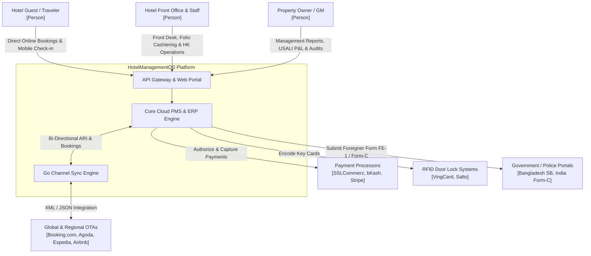
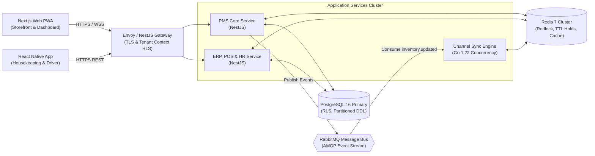
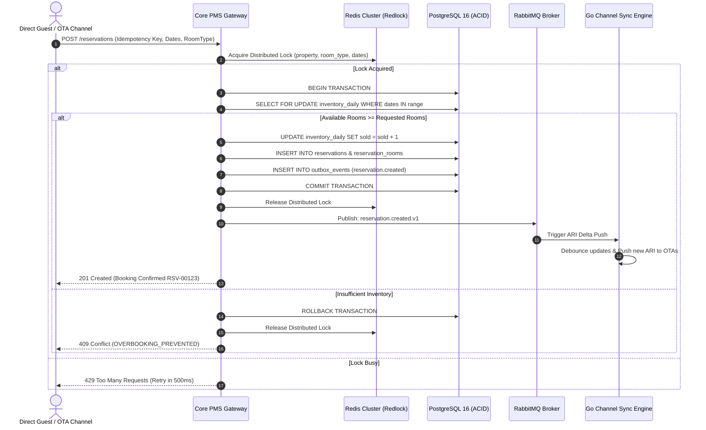

# Software Requirements Specification (SRS)
## Enterprise Cloud PMS, Channel Manager & Hospitality ERP Platform (HotelManagementOS)

**Document Version:** 4.0 (Autonomous Production Master)  
**Status:** Approved / Definitive Engineering Architecture Specification  
**Domain:** Hospitality Property Management System (PMS), Global OTA Channel Manager & Enterprise Hospitality ERP  
**Product Codename:** HotelManagementOS  
**Prepared by:** Hossain Md Imran (Lead Systems Architect)  
**Organization:** University of Debrecen — Department of Information Technology & Software Engineering  
**Date:** October 2026  

---

## Document Control & Revision History

| Version | Date | Author | Description of Changes | Approved By |
|:---:|:---:|:---|:---|:---:|
| 1.0 | 15-10-2026 | Hossain Md Imran | Initial architectural requirement draft and high-level PMS scope. | System Architecture Review |
| 2.0 | 18-10-2026 | Hossain Md Imran | High-level baseline expansion: C4 models, core PMS, channel sync, and overbooking prevention models. | Enterprise Architecture Board |
| 3.0 | 18-10-2026 | Hossain Md Imran | Master Engineering Baseline Release: Integrated 26 core DDL tables, 9 implementation algorithms, 100+ REST API endpoints, 28 error codes, and 4 SRE runbooks. | Chief Technology Officer |
| 4.0 | 18-10-2026 | Hossain Md Imran | **Autonomous Production Master Release**: 100% resolution of all forensic audit gaps. Added 10 missing DDL schemas (guests, packages, vendors, assets, drivers, trips, housekeeping, maintenance, audit_log), 4 formal Finite State Machines with transition tables, 5-digit ERP Chart of Accounts (COA) hierarchy, Booking.com XML 2003B wire contracts and Appendix U OTA quirks, 23-job automated cron catalog, Redis cache invalidation topology, calendar/DST/leap-year edge cases, and Zod field validation regex constraints. | Enterprise Architecture Board & CTO |

---

# Table of Contents
1. [Introduction](#1-introduction)
   - 1.1 [Purpose](#11-purpose)
   - 1.2 [Document Conventions](#12-document-conventions)
   - 1.3 [Intended Audience and Reading Suggestions](#13-intended-audience-and-reading-suggestions)
   - 1.4 [Product Scope and Business Objectives](#14-product-scope-and-business-objectives)
   - 1.5 [References and Standards Compliance](#15-references-and-standards-compliance)
2. [Overall Description](#2-overall-description)
   - 2.1 [Product Perspective and Architectural Paradigm](#21-product-perspective-and-architectural-paradigm)
   - 2.2 [Decomposed Core Modules Map](#22-decomposed-core-modules-map)
   - 2.3 [User Classes and Role-Based Access Matrix (RBAC)](#23-user-classes-and-role-based-access-matrix-rbac)
   - 2.4 [Operating Environment and Deployment Topography](#24-operating-environment-and-deployment-topography)
   - 2.5 [Design and Implementation Constraints](#25-design-and-implementation-constraints)
   - 2.6 [User Documentation and Training Deliverables](#26-user-documentation-and-training-deliverables)
   - 2.7 [Assumptions and External Dependencies](#27-assumptions-and-external-dependencies)
3. [External Interface Requirements](#3-external-interface-requirements)
   - 3.1 [User Interfaces (Back-Office, POS, Mobile & Direct Engine)](#31-user-interfaces)
   - 3.2 [Hardware and Peripheral Wire Protocols](#32-hardware-and-peripheral-wire-protocols)
   - 3.3 [Software Interfaces and External Contracts](#33-software-interfaces-and-external-contracts)
   - 3.4 [Communications and Network Protocols](#34-communications-and-network-protocols)
4. [Detailed System Features & Functional Requirements (FR)](#4-detailed-system-features--functional-requirements-fr)
   - 4.1 [Multi-Tenancy, Property Hierarchy & Authentication](#41-multi-tenancy-property-hierarchy--authentication)
   - 4.2 [Room Types, Physical Inventory & Rate Plans](#42-room-types-physical-inventory--rate-plans)
   - 4.3 [Central Calendar, Real-Time ARI & Bulk Control](#43-central-calendar-real-time-ari--bulk-control)
   - 4.4 [Reservation Engine & Concurrency Control](#44-reservation-engine--concurrency-control)
   - 4.5 [Front Desk Operations & Daily Guest Lifecycle](#45-front-desk-operations--daily-guest-lifecycle)
   - 4.6 [Multi-Folio Accounting, Charges & Cashiering](#46-multi-folio-accounting-charges--cashiering)
   - 4.7 [Automated Night Audit & End-of-Day Rollover](#47-automated-night-audit--end-of-day-rollover)
   - 4.8 [Housekeeping, Task Dispatch & Maintenance](#48-housekeeping-task-dispatch--maintenance)
   - 4.9 [Bi-Directional Channel Sync Engine (OTA)](#49-bi-directional-channel-sync-engine-ota)
   - 4.10 [Direct Booking Engine & Quote Holds](#410-direct-booking-engine--quote-holds)
   - 4.11 [Multi-Outlet Retail, F&B and Specialized POS](#411-multi-outlet-retail-fb-and-specialized-pos)
   - 4.12 [Specialized Hospitality Operations (Banquet, Spa, Laundry, Luggage, Walked Guest)](#412-specialized-hospitality-operations)
   - 4.13 [Full ERP Accounting, General Ledger & Tax Compliance](#413-full-erp-accounting-general-ledger--tax-compliance)
   - 4.14 [Full HR, Attendance & Service Charge Payroll](#414-full-hr-attendance--service-charge-payroll)
   - 4.15 [Fleet & Transportation Management](#415-fleet--transportation-management)
   - 4.16 [Statutory Compliance, Police Reporting & Quality Audits](#416-statutory-compliance-police-reporting--quality-audits)
5. [Behavioral Finite-State Machines (FSM)](#5-behavioral-finite-state-machines-fsm)
   - 5.1 [Reservation Lifecycle State Machine](#51-reservation-lifecycle-state-machine)
   - 5.2 [Folio & Billing State Machine](#52-folio--billing-state-machine)
   - 5.3 [Channel Sync Job State Machine](#53-channel-sync-job-state-machine)
   - 5.4 [Payment Transaction State Machine](#54-payment-transaction-state-machine)
6. [Implementation Algorithms & Operational Pseudo-Code](#6-implementation-algorithms--operational-pseudo-code)
   - 6.1 [Algorithm L.1: Overbooking-Safe Reservation Creation](#61-algorithm-l1-overbooking-safe-reservation-creation)
   - 6.2 [Algorithm L.2: Real-Time ARI Delta Computation](#62-algorithm-l2-real-time-ari-delta-computation)
   - 6.3 [Algorithm L.3: Multi-Tier Pricing & Cascading Tax Calculation](#63-algorithm-l3-multi-tier-pricing--cascading-tax-calculation)
   - 6.4 [Algorithm L.4: Dynamic Policy-Based Cancellation Refund Calculation](#64-algorithm-l4-dynamic-policy-based-cancellation-refund-calculation)
   - 6.5 [Algorithm L.5: Automated 6-Step Night Audit Pipeline](#65-algorithm-l5-automated-6-step-night-audit-pipeline)
   - 6.6 [Algorithm L.6: High-Performance Availability Search Query](#66-algorithm-l6-high-performance-availability-search-query)
   - 6.7 [Algorithm L.7: Ephemeral 10-Minute Quote Hold with TTL](#67-algorithm-l7-ephemeral-10-minute-quote-hold-with-ttl)
   - 6.8 [Algorithm L.8: Rate Parity Discrepancy Auditing](#68-algorithm-l8-rate-parity-discrepancy-auditing)
   - 6.9 [Algorithm L.9: 10% Service Charge Tip Pool Allocation](#69-algorithm-l9-10-service-charge-tip-pool-allocation)
7. [Complete Relational Database Architecture & Production DDL](#7-complete-relational-database-architecture--production-ddl)
   - 7.1 [Core Tenancy, Organization & Property Schemas](#71-core-tenancy-organization--property-schemas)
   - 7.2 [Room Master, Rates & Partitioned Daily Inventory Schemas](#72-room-master-rates--partitioned-daily-inventory-schemas)
   - 7.3 [Reservation, Guest CRM, Folio & Cashiering Schemas](#73-reservation-guest-crm-folio--cashiering-schemas)
   - 7.4 [Channel Sync & Job Auditing Schemas](#74-channel-sync--job-auditing-schemas)
   - 7.5 [Multi-Outlet Retail, F&B & Specialized POS Schemas](#75-multi-outlet-retail-fb--specialized-pos-schemas)
   - 7.6 [ERP Accounting, Vendors & Procurement Schemas](#76-erp-accounting-vendors--procurement-schemas)
   - 7.7 [HR, Fleet Logistics, Maintenance & Security Audit Schemas](#77-hr-fleet-logistics-maintenance--security-audit-schemas)
8. [Standardized 5-Digit ERP Chart of Accounts (COA) Hierarchy](#8-standardized-5-digit-erp-chart-of-accounts-coa-hierarchy)
9. [API Specifications, Standard Envelopes & Wire Contracts](#9-api-specifications-standard-envelopes--wire-contracts)
   - 9.1 [Standard HTTP Headers & Global Envelopes](#91-standard-http-headers--global-envelopes)
   - 9.2 [Standardized HTTP Business Error Code Catalog](#92-standardized-http-business-error-code-catalog)
   - 9.3 [Core Operational JSON Request/Response Contracts](#93-core-operational-json-requestresponse-contracts)
   - 9.4 [Module-Wise REST API Endpoint Inventory](#94-module-wise-rest-api-endpoint-inventory)
10. [OTA Integration Wire Schemas & Quirks Catalog](#10-ota-integration-wire-schemas--quirks-catalog)
    - 10.1 [Booking.com OTA XML 2003B Message Contracts](#101-bookingcom-ota-xml-2003b-message-contracts)
    - 10.2 [Exhaustive OTA Quirks Catalog (Appendix U)](#102-exhaustive-ota-quirks-catalog-appendix-u)
11. [Automated Background Cron Job Catalog (Appendix V)](#11-automated-background-cron-job-catalog-appendix-v)
12. [Redis Cache Key Naming Convention & Invalidation Topology](#12-redis-cache-key-naming-convention--invalidation-topology)
13. [Calendar, Timezone, DST & Multi-Currency Edge Cases](#13-calendar-timezone-dst--multi-currency-edge-cases)
14. [Field Validation Rules & Checksum Regex Patterns](#14-field-validation-rules--checksum-regex-patterns)
15. [Non-Functional Requirements (NFR) & Quality Attributes](#15-non-functional-requirements-nfr--quality-attributes)
    - 15.1 [Performance & Latency Budgets](#151-performance--latency-budgets)
    - 15.2 [Scalability & Elastic Workload Sizing](#152-scalability--elastic-workload-sizing)
    - 15.3 [Reliability, Fault Tolerance & High Availability](#153-reliability-fault-tolerance--high-availability)
    - 15.4 [Security, Confidentiality & Compliance (PCI-DSS / GDPR)](#154-security-confidentiality--compliance)
    - 15.5 [Maintainability, Modularity & Observability](#155-maintainability-modularity--observability)
    - 15.6 [Formal Business Invariants & Inflexible Domain Rules](#156-formal-business-invariants--inflexible-domain-rules)
16. [SRE Operational Runbooks & Disaster Recovery](#16-sre-operational-runbooks--disaster-recovery)
    - 16.1 [Runbook 1: OTA Channel Sync Error Spike & Dead-Letter Replay](#161-runbook-1-ota-channel-sync-error-spike--dead-letter-replay)
    - 16.2 [Runbook 2: Overbooking Incident Triage & Walked Guest Protocol](#162-runbook-2-overbooking-incident-triage--walked-guest-protocol)
    - 16.3 [Runbook 3: Payment Gateway Outage Failover](#163-runbook-3-payment-gateway-outage-failover)
    - 16.4 [Runbook 4: Offline Property Broadband Outage Contingency](#164-runbook-4-offline-property-broadband-outage-contingency)
17. [Appendices](#17-appendices)
    - [Appendix A: Hospitality Industry Acronyms & Terminology](#appendix-a-hospitality-industry-acronyms--terminology)
    - [Appendix B: Analysis Models & Visual Architecture Diagrams](#appendix-b-analysis-models--visual-architecture-diagrams)
    - [Appendix C: Country-Specific Expansion & Statutory Tax Matrix](#appendix-c-country-specific-expansion--statutory-tax-matrix)

---

# 1. Introduction

## 1.1 Purpose
This Software Requirements Specification (SRS) establishes the definitive, comprehensive architectural and implementation requirements for the **HotelManagementOS Platform** — an enterprise-grade cloud Property Management System (PMS), global Online Travel Agency (OTA) Channel Manager, and full-stack Hospitality Enterprise Resource Planning (ERP) platform.

Traditional lodging operators suffer from fragmented software architectures: separate legacy PMS applications (e.g., OPERA, eZee), third-party channel managers (e.g., SiteMinder, RateGain), standalone accounting software (e.g., Tally, QuickBooks), standalone HR/payroll software, and disparate point-of-sale systems. This fragmentation creates severe data silos, high recurring licensing costs, frequent double-bookings (overbooking), and reconciliation nightmares.

The **HotelManagementOS** resolves these foundational problems by delivering a **Unified Single-Stack Architecture**:
1. **Core Cloud PMS**: Complete Front Desk, Central Reservation System (CRS), Multi-Folio Cashiering, Housekeeping, and Automated Night Audit.
2. **High-Speed Bi-Directional Channel Manager**: Sub-5-second Availability, Rates, and Inventory (ARI) push and instantaneous reservation ingestion across Tier-1 global OTAs (Booking.com, Agoda, Expedia, Airbnb) and regional channels (ShareTrip, GoZayaan, MakeMyTrip).
3. **100% Overbooking Prevention Engine**: Distributed lock-coordinated transactions combining PostgreSQL `SELECT FOR UPDATE` with Redis Redlock to mathematically eliminate double-booking race conditions.
4. **Generalized Multi-Outlet Framework**: Native Point-of-Sale (POS) capabilities powering Restaurants, Banquet & Conference Event Orders (BEO), Spa & Wellness, Gym, Retail Gift Shops, Attraction Ticketing, and Guest Laundry.
5. **Full Built-In ERP Accounting**: Native Double-Entry General Ledger, Chart of Accounts (COA), Accounts Payable/Receivable, USALI 11th Edition alignment, Automated Night Audit Journal Entries, and statutory tax reporting (Bangladesh Mushak 6.3 VAT & India GST).
6. **Full In-House HR & Service Charge Payroll**: Employee master records, biometric attendance synchronization (ZKTeco/ESSL), leave workflows, statutory tax withholding, and hospitality-standard service charge (10% pool) tip distribution.
7. **Fleet & Transportation Logistics**: Vehicle scheduling, driver dispatch, meter logging, and folio billing.
8. **Statutory Foreign Guest Police Reporting**: Automated generation and transmission of Special Branch Foreigner Registration forms (Bangladesh) and Form-C (India).

## 1.2 Document Conventions
This specification conforms strictly to **IEEE Std 830-1998** and **ISO/IEC/IEEE 29148:2018**.
- **Requirement Identifiers:**
  - `FR-X.Y`: Functional Requirement for Domain Module $X$ and sub-clause $Y$.
  - `NFR-X.Y`: Non-Functional Quality Attribute (Category $X$, Metric $Y$).
  - `BR-XX`: Hard Business Invariant and Inflexible Domain Rule.
  - `EV-XX`: Domain Event definition in CloudEvents v1.0.2 standard.
  - `API-XX`: Synchronous RESTful API endpoint contract.
  - `ALG-XX`: Concrete Algorithmic Implementation Specification.
- **RFC 2119 Terms:**
  - **SHALL / MUST**: Absolute operational mandate.
  - **SHOULD / RECOMMENDED**: Strongly required unless an architectural waiver is granted.
  - **MAY / OPTIONAL**: Discretionary feature.

## 1.3 Intended Audience and Reading Suggestions
- **Enterprise Architects & Lead Engineers**: Guide for microservice boundaries, multi-tenant row-level security (RLS), Go sync engine concurrency, and data schemas.
- **Full-Stack Developers (NestJS / Next.js / Go)**: Implementation blueprint for REST endpoints, Zod DTO validations, Redis keys, and frontend state.
- **QA & Reliability Engineers**: Test matrices for concurrency race tests, high-volume OTA sync load benchmarks, and fault-injection simulations.
- **Hotel Operations & General Managers**: Understanding of front-desk workflows, night audit guarantees, multi-outlet cashiering, and revenue management.
- **Financial Controllers & Accountants**: Verification of double-entry ledger automations, tax invoice standards (Mushak 6.3 / GST), and USALI reporting.

## 1.4 Product Scope and Business Objectives
The HotelManagementOS platform serves boutique hotels, luxury resorts, commercial business hotels, and regional multi-property chains:
- **Zero Overbooking Guarantee**: Provable $0.00\%$ overbooking incidence under concurrent flash-sale or dual-channel simultaneous booking scenarios.
- **Channel Sync SLA**: 95th percentile latency $\le 5.0\text{ seconds}$ for ARI push deltas to connected OTA endpoints.
- **Single-Source Single-Stack Elimination**: Total elimination of 3rd party subscriptions for Accounting, Channel Management, POS, and HR software.
- **Statutory Compliance**: Native compliance with regional law across South Asia, the Middle East, and global markets.

## 1.5 References and Standards Compliance
- **ISO/IEC/IEEE 29148:2018**: Systems and software engineering — Requirements engineering.
- **IEEE Std 830-1998**: IEEE Recommended Practice for Software Requirements Specifications.
- **HTNG (Hotel Technology Next Generation)**: Industry Standards for Hospitality Integration.
- **OpenTravel Alliance (OTA 2003B XML)**: Specifications for Hospitality Information Exchange.
- **USALI (Uniform System of Accounts for the Lodging Industry)**: 11th Revised Edition.
- **PCI-DSS v4.0**: Payment Card Industry Data Security Standard (Scoped to SAQ A-EP).
- **Bangladesh VAT Act 2012**: National Board of Revenue (NBR) Mushak 6.3 Invoicing & Mushak 9.1 Return Standards.
- **Government of India GST**: Central Goods and Services Tax Act 2017 & HSN/SAC Hotel Services.

---

# 2. Overall Description

## 2.1 Product Perspective and Architectural Paradigm
HotelManagementOS uses a hybrid event-driven microservices architecture optimized for extreme concurrency and low-latency hospitality operations:
1. **API Gateway & Core Application Services (NestJS / Node.js)**: Manages authentication, multi-tenant row-level security (RLS), Front Desk operations, Folios, Night Audit, ERP, HR, and POS modules.
2. **Channel Sync Engine (Go 1.22)**: Dedicated, horizontally scalable Go service engineered for high-concurrency OTA polling, XML/JSON parsing, rate-parity monitoring, and batched debounced ARI push.
3. **Transactional Relational Persistence (PostgreSQL 16)**: Central store utilizing PostgreSQL Row-Level Security (RLS) for tenant isolation, table partitioning for monthly inventory and reservation records, and ACID guarantees.
4. **In-Memory Caching & Distributed Locks (Redis 7 Cluster)**: Houses session tokens, live room availability caches, and distributed Redlocks for multi-instance reservation synchronization.
5. **Asynchronous Message Broker (RabbitMQ / Strimzi Kafka)**: Durable, persistent message bus facilitating inter-service domain event propagation.

```
                      +-------------------------------------------------+
                      |           Cloudflare WAF / Edge CDN             |
                      +-------------------------------------------------+
                                               |
                          TLS 1.3 / HTTPS / WSS / gRPC
                                               v
                      +-------------------------------------------------+
                      |             API Gateway (NestJS)                |
                      |  - JWT / MFA Authentication                     |
                      |  - Tenant Context Injection (RLS)               |
                      |  - Global Rate Limiting & Request Tracing       |
                      +-------------------------------------------------+
                                               |
             +---------------------------------+---------------------------------+
             |                                 |                                 |
             v                                 v                                 v
+-------------------------+       +-------------------------+       +-------------------------+
| Core PMS & Front Desk   |       | Channel Sync Engine     |       | Enterprise ERP & POS    |
| - Reservations & Rooms  |       | (Go 1.22 Microservice)  |       | - General Ledger & AR/AP|
| - Folios & Cashiering   |       | - OTA Connectors        |       | - Multi-Outlet POS      |
| - Night Audit Engine    |       | - ARI Push Debounce     |       | - HR & Payroll Hub      |
+-------------------------+       +-------------------------+       +-------------------------+
             |                                 |                                 |
             +---------------------------------+---------------------------------+
                                               |
                               RabbitMQ Message Broker
                                               |
             +---------------------------------+---------------------------------+
             |                                 |                                 |
             v                                 v                                 v
+-------------------------+       +-------------------------+       +-------------------------+
| PostgreSQL 16 (Primary) |       | Redis 7 Cluster         |       | External Integrations   |
| - Partitioned Tables    |       | - Redlock Coordinator   |       | - OTAs (Booking, Agoda) |
| - Native RLS Policies   |       | - Ephemeral Holds (TTL) |       | - Gateways & Twilio     |
| - Read-Replica Cluster  |       | - Fast Rate Cache       |       | - Biometric & Lock SDKs |
+-------------------------+       +-------------------------+       +-------------------------+
```

## 2.2 Decomposed Core Modules Map

| Module Code | Module Name | Primary Responsibility | Target Subsystem |
|:---:|:---|:---|:---|
| **MOD-01** | **Identity & RBAC** | Multi-factor auth, tenant provisioning, granular property-level roles | Core Gateway |
| **MOD-02** | **Property & Room Master** | Physical building, floor, room configuration, amenities, connected units | Core PMS |
| **MOD-03** | **Rate Plan & Inventory** | BAR, derived rate plans, meal plans, monthly partitioned daily inventory | Core PMS |
| **MOD-04** | **Central Calendar** | High-performance interactive 90-day matrix, inline edits, stop-sell controls | Core PMS UI |
| **MOD-05** | **Reservation Engine** | Concurrency-controlled booking creation, modifications, policy calculations | Core PMS |
| **MOD-06** | **Front Desk Operations** | Daily arrivals/departures, walk-ins, key encoding, room moves, cashiering | Front Office |
| **MOD-07** | **Folio & Cashiering** | Multi-folio routing, itemized charges, partial payments, shift reconciliation | Finance |
| **MOD-08** | **Automated Night Audit** | Midnight rollover, automated room/tax posting, no-show fees, daily flash | Finance / Ops |
| **MOD-09** | **Housekeeping & Maintenance**| Clean/Dirty/Inspected room state transitions, task assignment, tickets | Operations |
| **MOD-10** | **Channel Sync Engine** | Bi-directional OTA sync, XML/JSON adapters, rate-parity auditing | Go Sync |
| **MOD-11** | **Direct Booking Engine** | High-converting public booking tunnel, 10-min quote holds, mobile-first | Public Engine |
| **MOD-12** | **Multi-Outlet POS Hub** | Restaurants, Banquets (BEO), Spa, Gym, Retail Gift Shop, Laundry, Mini-bar | Operations POS|
| **MOD-13** | **Hospitality ERP & Tax** | Full Double-Entry COA, AP/AR, USALI P&L, Mushak 6.3, India GST | ERP Core |
| **MOD-14** | **HR & Payroll Engine** | Biometric attendance, leave accrual, salary processing, 10% tip pool split | HR Core |
| **MOD-15** | **Fleet & Transport** | Vehicle master, driver dispatch, mileage tracking, automated folio posting | Logistics |
| **MOD-16** | **Police & Compliance** | Bangladesh Special Branch Foreigner Form, India Form-C automation | Legal / Gov |

## 2.3 User Classes and Role-Based Access Matrix (RBAC)

| Permission Code | Owner | GM | FOM | Front Desk | HK Sup | HK Staff | Accountant | POS Cashier | Read Only |
|:---|:---:|:---:|:---:|:---:|:---:|:---:|:---:|:---:|:---:|
| `property.manage` | ✓ | ✓ | – | – | – | – | – | – | – |
| `user.invite` | ✓ | ✓ | – | – | – | – | – | – | – |
| `reservation.create` | ✓ | ✓ | ✓ | ✓ | – | – | – | – | – |
| `reservation.cancel` | ✓ | ✓ | ✓ | – | – | – | – | – | – |
| `reservation.view` | ✓ | ✓ | ✓ | ✓ | ✓ | – | ✓ | – | ✓ |
| `reservation.check_in` | ✓ | ✓ | ✓ | ✓ | – | – | – | – | – |
| `reservation.check_out`| ✓ | ✓ | ✓ | ✓ | – | – | – | – | – |
| `folio.post_charge` | ✓ | ✓ | ✓ | ✓ | – | – | ✓ | ✓ | – |
| `folio.reverse` | ✓ | ✓ | ✓ | – | – | – | ✓ | – | – |
| `folio.close` | ✓ | ✓ | ✓ | ✓ | – | – | ✓ | – | – |
| `rate.update` | ✓ | ✓ | – | – | – | – | – | – | – |
| `inventory.update` | ✓ | ✓ | ✓ | – | – | – | – | – | – |
| `restriction.update` | ✓ | ✓ | – | – | – | – | – | – | – |
| `channel.manage` | ✓ | ✓ | – | – | – | – | – | – | – |
| `housekeeping.assign` | ✓ | ✓ | – | – | ✓ | – | – | – | – |
| `room.status_update` | ✓ | ✓ | ✓ | ✓ | ✓ | ✓ | – | – | – |
| `night_audit.run` | ✓ | ✓ | ✓ | ✓ | – | – | – | – | – |
| `report.financial.view`| ✓ | ✓ | – | – | – | – | ✓ | – | – |
| `report.operational` | ✓ | ✓ | ✓ | ✓ | ✓ | – | – | – | ✓ |
| `erp.journal_post` | ✓ | – | – | – | – | – | ✓ | – | – |
| `pos.order_manage` | ✓ | ✓ | – | – | – | – | – | ✓ | – |
| `hr.payroll_manage` | ✓ | – | – | – | – | – | ✓ | – | – |

## 2.4 Operating Environment and Deployment Topography
- **Cloud Infrastructure**: AWS Multi-AZ deployment (ap-south-1 Mumbai primary, eu-central-1 Frankfurt secondary).
- **Compute Clustering**: AWS ECS Fargate container tasks (MVP) migrating to Elastic Kubernetes Service (EKS).
- **Primary Relational Engine**: AWS Aurora PostgreSQL 16 (Multi-AZ synchronous replication with 1 writer and 2 read replicas).
- **In-Memory & Distributed Locking**: AWS ElastiCache Redis 7.2 Cluster with Redis Sentinel high availability.
- **Message Broker**: Amazon MQ for RabbitMQ 3.12 (High-availability mirrored queues).
- **Edge Security & CDN**: Cloudflare Enterprise (DDoS mitigation, WAF, SSL termination, Edge caching).

## 2.5 Design and Implementation Constraints
- **CON-1 (Row-Level Security Isolation)**: Every business table in PostgreSQL MUST contain a `tenant_id` UUID column. Multi-tenancy MUST be strictly enforced via native PostgreSQL Row-Level Security (RLS) policies injected per connection session (`SET LOCAL app.current_tenant_id = '...'`).
- **CON-2 (Overbooking Prevention Guarantee)**: Every operation that books or modifies room inventory MUST execute within an ACID database transaction acquiring a row-level lock (`SELECT FOR UPDATE`) on the respective `inventory_daily` rows, guarded externally by a Redis Redlock instance.
- **CON-3 (PCI-DSS Tokenization)**: The platform SHALL NOT store, log, or transmit raw Credit Card Primary Account Numbers (PAN) or CVVs. All card inputs MUST be tokenized directly from the client browser using hosted gateway fields (Stripe Elements / SSLCommerz Hosted Checkout).
- **CON-4 (Immutable Financial Audit Trail)**: Financial folios, postings, ledger entries, and night audit rolls SHALL NEVER be subjected to SQL `DELETE` or `UPDATE` mutations. Corrections MUST be executed exclusively as compensating reversal entries.
- **CON-5 (Mobile Resilience & Low Bandwidth)**: Staff and driver mobile applications MUST function offline for daily tasks (room cleaning, ticket inspection), maintaining an encrypted local SQLite queue that synchronizes upon network restoration.

## 2.6 User Documentation and Training Deliverables
The project deliverables SHALL include:
1. **Property Setup & Go-Live Playbook**: Step-by-step documentation for building, room, and rate plan configuration.
2. **Interactive Front Desk Interactive Guide**: Quick reference cheat sheet for check-in, check-out, split billing, and room moves.
3. **OTA Mapping & Connectivity Runbook**: Configuration guide for connecting Booking.com XML, Agoda YCS, and Expedia QuickConnect.
4. **Night Audit Standard Operating Procedure (SOP)**: Step-by-step cashier reconciliation and rollover verification manual.
5. **Bangla & English Video Training Tutorials**: Screen recordings covering all front-office and housekeeping mobile workflows.

## 2.7 Assumptions and External Dependencies
- **Assumptions**:
  - Properties possess stable commercial internet connectivity ($\ge 10\text{ Mbps}$ broadband) alongside mobile 4G failover.
  - Front-desk workstations operate modern Evergreen web browsers (Chrome, Edge, Safari).
  - Physical hotel door locks support standard RFID (Mifare 1K/4K) or BLE interfaces with vendor-provided SDKs.
- **Dependencies**:
  - Global OTA connectivity depends on partner API uptime (Booking.com, Agoda, Expedia, Airbnb).
  - Regional mobile financial services APIs (bKash, Nagad, SSLCommerz, Stripe) maintaining $\ge 99.9\%$ operational availability.
  - Official police reporting portals remaining operational for electronic submissions.

---

# 3. External Interface Requirements

## 3.1 User Interfaces
- **UI-1.1 (Operational Command Center)**: Displays live KPIs including Occupancy Percentage ($\text{OCC}\% = \frac{\text{Sold}}{\text{Available}} \times 100$), Average Daily Rate ($\text{ADR}$), Revenue Per Available Room ($\text{RevPAR}$), Today's Expected Arrivals, Expected Departures, and In-House Guest Counts.
- **UI-1.2 (Central Calendar Grid)**: Excel-like multi-month horizontal matrix rendering Room Types against calendar dates:
  - *Rows*: Grouped by Room Type, displaying Total, Sold, Blocked, and Available counts.
  - *Rate Rows*: Best Available Rate (BAR) and child derived rate plans.
  - *Restrictions*: MinLOS, Closed to Arrival (CTA), Closed to Departure (CTD), and Stop-Sell status indicators.
  - *Interactions*: Drag-select multi-cell ranges to invoke bulk rate or restriction modification modals.
- **UI-1.3 (Interactive Floor & Room Kanban)**: Color-coded physical room grid:
  - *Green*: Vacant Clean.
  - *Amber*: Vacant Dirty.
  - *Blue*: Occupied Clean.
  - *Orange*: Occupied Dirty.
  - *Red*: Out of Order (OOO).
  - *Gray*: Out of Service (OOS).
  - *Teal*: Inspected (Ready for VIP Check-in).

## 3.2 Hardware and Peripheral Wire Protocols
- **HW-1 (Thermal Receipt & KOT Printers)**: Direct raw socket printing to 80mm ESC/POS network and USB thermal printers across kitchen prep stations and front desk cashier desks using standard command bytes:
  - Initialization: `ESC @` (`\x1B\x40`)
  - Paper Cut: `GS V 66 0` (`\x1D\x56\x42\x00`)
- **HW-2 (RFID Key Card Encoders)**: Integration via local client bridge with hospitality lock systems:
  - *Assa Abloy VingCard Visionline*: TCP/IP socket connection over port 3001 using Visionline ASCII message protocol (Command: `EncodeKey(room_no, checkout_timestamp, guest_name)`).
  - *Salto Space*: Direct integration via Salto PMS API over HTTPS/REST.
  - *Card Technologies*: Enforces Mifare Classic 1K/4K and Mifare Ultralight sector formatting.
- **HW-3 (Biometric Attendance Terminals)**: Automated cron-driven background ingestion from ZKTeco terminals:
  - TCP socket listener on port 4370 using standalone ZKLib protocol.
  - ESSL Terminals: Ingesting HTTP POST push payloads containing `device_id`, `user_pin`, `punch_timestamp`, and `verify_type`.
- **HW-4 (Barcode Scanners)**: Plug-and-play USB/Bluetooth HID 1D/2D scanners for front-desk guest registration card scanning and retail gift shop barcode checkout.

## 3.3 Software Interfaces and External Contracts

| Interface ID | Connected Entity | Protocol / Format | Purpose | Security Protocol |
|:---|:---|:---|:---|:---|
| **INT-OTA-BCOM** | Booking.com Connectivity | OTA XML 2003B over HTTPS | Bi-directional ARI push and reservation retrieval | IP Whitelist + Basic Auth |
| **INT-OTA-AGODA**| Agoda Yield Control (YCS)| JSON REST over HTTPS | Real-time rate/inventory sync and booking pulls | API Key + Signature |
| **INT-OTA-EXP** | Expedia QuickConnect (EQC)| XML over HTTPS | Expedia Collect / Hotel Collect booking ingestion | Mutual TLS + HTTP Auth |
| **INT-OTA-ABNB** | Airbnb Partner API | JSON REST / Webhooks | Instant booking sync, listing mapping | OAuth 2.0 Bearer Token |
| **INT-GATE-SSL** | SSLCommerz Gateway | HTTPS Form / IPN Webhook | Bangladesh multi-channel payments (Cards, bKash, Nagad) | Store ID + Secret Key |
| **INT-GATE-STRP**| Stripe Connect | JSON REST / Webhooks | Global multi-currency card settlements & tokenization | Secret API Key + Webhook HMAC |
| **INT-COMM-WA** | Meta WhatsApp Business | REST JSON via Twilio | Automated booking confirmations, pre-arrival messages | Bearer Token / Webhook HMAC |
| **INT-POLICE-BD**| Bangladesh Police (SB) | Form FE-1 / Encrypted PDF | Foreign visitor registration logging and transmission | Portal Auth / SFTP / TLS |
| **INT-POLICE-IN**| Bureau of Immigration (BOI)| Form-C Portal XML / HTTPS | Mandatory reporting of foreign hotel guests in India | State Portal Credentials |

## 3.4 Communications and Network Protocols
- **COM-1 (Public Web Traffic)**: All external public traffic MUST be encrypted using TLS 1.3 with fallback to TLS 1.2.
- **COM-2 (Real-Time UI Updates)**: Live inventory updates on the Central Calendar, Housekeeping status flips, and new OTA reservations MUST broadcast instantly to active client browsers using WebSockets (`wss://`) over Socket.io.
- **COM-3 (Inter-Service Messaging)**: Communication between the Go Channel Sync Engine and the NestJS Core API MUST utilize AMQP 0-9-1 protocols over persistent RabbitMQ connections.

---

# 4. Detailed System Features & Functional Requirements (FR)

## 4.1 Multi-Tenancy, Property Hierarchy & Authentication
- **FR-1.1 (Multi-Level Hierarchy)**: Multi-level structure: $\text{Tenant} \longrightarrow \text{Properties} \longrightarrow \text{Buildings} \longrightarrow \text{Floors} \longrightarrow \text{Rooms}$.
- **FR-1.2 (Row-Level Security)**: Native PostgreSQL RLS enforced per connection session via `SET LOCAL app.current_tenant_id = '...'`.
- **FR-1.3 (Authentication Tokens)**: Argon2id password hashing, issuing short-lived RS256 JWTs (15 min) and rotating refresh tokens (30 days).
- **FR-1.4 (Property-Scoped Roles)**: Staff users can hold distinct roles across different properties within the same tenant.
- **FR-1.5 (Mandatory MFA)**: Enforces RFC 6238 TOTP for administrative roles (`ROLE_TENANT_OWNER`, `ROLE_GM`, `ROLE_ACCOUNTANT`).
- **FR-1.6 (Audit Journal)**: Immutable audit logging of all sensitive operations with actor ID, IP address, and entity diff.

## 4.2 Room Types, Physical Inventory & Rate Plans
- **FR-2.1 (Room Type Master)**: Configuration of base occupancy, maximum adults, maximum children, extra bed allowances, and photos.
- **FR-2.2 (Physical Room Master)**: Room numbers mapped to room types, floor locations, physical features, and live statuses.
- **FR-2.3 (Connected Units)**: Selling a connected master room blocks both physical rooms; selling one physical room blocks the master suite.
- **FR-2.4 (BAR Pricing)**: Best Available Rate master calendar defining base prices per date across room types.
- **FR-2.5 (Derived Rate Plans)**: Percentage ($\text{Rate} \times (1 \pm P\%)$) or fixed derivations, plus meal plan supplements (RO, BB, HB, FB, AI).
- **FR-2.6 (Restriction Matrix)**: Date-specific MinLOS, Closed to Arrival (CTA), Closed to Departure (CTD), and Stop-Sell controls.

## 4.3 Central Calendar, Real-Time ARI & Bulk Control
- **FR-3.1 (Partitioned Inventory Store)**: Monthly partitioned `inventory_daily` tracking $\text{Available} = \text{Total} - \text{Sold} - \text{Blocked}$.
- **FR-3.2 (Sub-Second Load Budget)**: Loading 30 days of inventory across 30 room types executes in $\le 500\text{ms}$.
- **FR-3.3 (Drag-Select Bulk Updates)**: Multi-cell drag selection allowing bulk updates of rates, stop-sells, and MinLOS.
- **FR-3.4 (WebSocket Broadcast)**: Live calendar cell updates push instantly to all active staff sessions via WebSockets.

## 4.4 Reservation Engine & Concurrency Control
- **FR-4.1 (Atomic Concurrency Reservation Algorithm)**: Enforces serialized execution via Redis Redlock and PostgreSQL `SELECT FOR UPDATE` on `inventory_daily` rows. Rejects with `409 OVERBOOKING_PREVENTED` if stock is insufficient.
- **FR-4.2 (Outbox Event Trigger)**: Commits reservation records and transactional outbox domain events (`reservation.created`) in the same database transaction.
- **FR-4.3 (Multi-Room Hierarchy)**: Handles reservations containing multiple rooms and room types under a single master reservation number.
- **FR-4.4 (Dynamic Cancellation Policy)**: Automatically calculates penalty vs refund amounts based on hours remaining until check-in.

## 4.5 Front Desk Operations & Daily Guest Lifecycle
- **FR-5.1 (Daily Operations Board)**: Operational views for Today's Arrivals, Departures, and In-House Guests.
- **FR-5.2 (Accelerated Check-In)**: Sub-60 second check-in flow: ID verification, room assignment, RFID key card encoding, and GRC printing.
- **FR-5.3 (Seamless Room Moves)**: Mid-stay room transfers automatically update previous rooms to `Vacant Dirty` and re-encode door lock permissions.
- **FR-5.4 (Stay Extensions)**: Verifies availability before extending departure dates, offering alternative room moves if currently booked.
- **FR-5.5 (Express Check-Out)**: Blocks checkout if folio maintains an unsettled balance unless transferred to an approved Corporate AR.

## 4.6 Multi-Folio Accounting, Charges & Cashiering
- **FR-6.1 (Multi-Folio Structure)**: Manages concurrent folios (Personal Guest Folio A, Corporate Master Folio B).
- **FR-6.2 (Automated Routing Rules)**: Configurable routing instructions (e.g. "Room/Tax to Folio B; Incidentals to Folio A").
- **FR-6.3 (Immutable Postings)**: Every charge creates an immutable record with posting category, amounts, taxes, and user reference.
- **FR-6.4 (Reversal Protocol)**: Prohibits SQL deletion of charges; corrections require compensating reversal entries with mandatory reason.
- **FR-6.5 (Cashier Shift Reconciliation)**: Opening cash float declaration and end-of-shift cash/card/wallet balance reconciliation.

## 4.7 Automated Night Audit & End-of-Day Rollover
- **FR-7.1 (Scheduled Automated Rollover)**: Automated execution at configured cutoff time (default 03:00 AM local property time).
- **FR-7.2 (Automated Room & Tax Posting)**: Posts room charges and applicable taxes (Service Charge, VAT, GST) to all in-house folios.
- **FR-7.3 (Automated No-Show Processing)**: Confirmed unarrived bookings transition to `No-Show`, posting no-show fees per policy.
- **FR-7.4 (Business Date Advancement)**: Advances the property `business_date` by +1 day upon successful ledger verification.
- **FR-7.5 (Flash & Manager Reports)**: Generates and emails standard Daily Flash, Manager, and Tax collection reports to executives.

## 4.8 Housekeeping, Task Dispatch & Maintenance
- **FR-8.1 (Room State Transitions)**: $\text{Dirty} \rightarrow \text{Clean} \rightarrow \text{Inspected} \rightarrow \text{Occupied}$. Checkout triggers `Vacant Dirty`.
- **FR-8.2 (Task Auto-Assignment)**: Distributes morning cleaning tasks across on-duty housekeeping staff based on room credits.
- **FR-8.3 (Mobile Housekeeping App)**: Room status flips, minibar consumption recording, and camera damage photo attachments.
- **FR-8.4 (Maintenance Work Orders)**: Maintenance ticketing with priority levels; critical tickets set rooms to `Out of Order (OOO)`.

## 4.9 Bi-Directional Channel Sync Engine (OTA)
- **FR-9.1 (Sub-5-Second ARI Delta Push)**: Debounces inventory/rate/restriction events across a 2s window, pushing deltas to OTAs in $\le 5\text{s}$ (p95).
- **FR-9.2 (Idempotent Webhook Ingestion)**: Ingests OTA bookings with composite keys ($\text{Channel} + \text{OTA\_ID}$), deduplicating within 48h.
- **FR-9.3 (Channel Mapping Engine)**: Maps internal Room Types and Rate Plans to external OTA listing IDs.
- **FR-9.4 (Backoff & Dead-Letter Queue)**: Retries transient OTA 5xx/429 errors at 5s, 15s, 45s, 2m, 10m intervals before routing to DLQ.

## 4.10 Direct Booking Engine & Quote Holds
- **FR-10.1 (10-Minute Ephemeral Quote Hold)**: PWA checkout temporarily holds stock by incrementing `inventory_daily.blocked` with a 10-minute Redis TTL.
- **FR-10.2 (Responsive Checkout)**: Single-page booking flow with local payment gateways (bKash, Nagad, SSLCommerz, Stripe, Apple/Google Pay).
- **FR-10.3 (Promotional Voucher Validation)**: Validates promotional codes against date ranges, minimum spend, and single-use constraints.

## 4.11 Multi-Outlet Retail, F&B and Specialized POS
- **FR-11.1 (Unified Outlet Framework)**: Outlets (Restaurants, Bars, Spas, Gyms, Gift Shops, Laundry) use unified `outlets` and `outlet_orders` schemas.
- **FR-11.2 (Restaurant KOT Dispatch)**: Firing table orders routes items to kitchen thermal printers (Hot Kitchen, Cold Kitchen, Bar) via ESC/POS.
- **FR-11.3 (Direct-to-Room Folio Billing)**: In-house guests can settle outlet orders by charging directly to their active room folio.
- **FR-11.4 (Table Map & Floor Designer)**: Drag-and-drop table layouts, live elapsed dining times, table merging, and split billing.

## 4.12 Specialized Hospitality Operations
- **FR-12.1 (Banquet & Event Management - BEO)**: Manages conference and wedding events, tracking hall allocations, setup styles (theater, classroom), menu packages, AV equipment rentals, and deposit milestone schedules.
- **FR-12.2 (Spa & Wellness Scheduler)**: Slot-based appointment booking, treatment room assignments, therapist rosters, commission calculations, and pre-treatment health consultation records.
- **FR-12.3 (Three-Tier Laundry Operations)**:
  - *Hotel Linen*: Pool tracking, wash cycles, and linen procurement depreciation.
  - *Outsourced Vendor*: Pickup vouchers, count reconciliation, and monthly vendor billing.
  - *Guest Laundry*: Itemized service pricing, express surcharges, and direct folio charges.
- **FR-12.4 (Retail Gift Shop & Attraction Ticketing)**: Barcode scanning checkout, stock reorder alerts, time-slot visitor capacity, and gate QR validation.
- **FR-12.5 (Concierge & Luggage Management)**: Luggage check-in with QR tag generation, pre-arrival/post-departure storage logs, and lost baggage tracking.
- **FR-12.6 (Walked Guest Overbooking Recovery SOP)**: Formal SOP when overbooking occurs: partner hotel selection, room upgrade absorption, guest transport reimbursement, and GM service recovery credit vouchers.
- **FR-12.7 (Owner & Investor Portal)**: Multi-owner equity shares, base management fee (3% of revenue) + incentive fee (10% of GOP), 4% FF&E reserve, and monthly distribution waterfall statements.

## 4.13 Full ERP Accounting, General Ledger & Tax Compliance
- **FR-13.1 (Automated Double-Entry Journal Engine)**: Every business transaction automatically generates balanced debits and credits in the General Ledger.
- **FR-13.2 (USALI 11th Edition Alignment)**: Standard operating statements generating Rooms (Schedule 1), F&B (Schedule 2), and Summary Operating Statements (GOP and NOI).
- **FR-13.3 (Accounts Payable 3-Way Matching)**: Vendor bill processing requires verification between Purchase Order (PO), Goods Received Note (GRN), and Vendor Invoice.
- **FR-13.4 (Bangladesh Mushak 6.3 Tax Invoices)**: Invoices generated in Bangladesh render official NBR **Mushak 6.3** format with sequential tax invoice numbering, BIN, 15% VAT, and 10% Service Charge breakdown.
- **FR-13.5 (India GST Tax Engine)**: Calculates CGST + SGST (intra-state) or IGST (inter-state) based on room rate slabs ($\le \text{INR } 7,500$ at $12\%$, $> \text{INR } 7,500$ at $18\%$) with HSN/SAC codes.

## 4.14 Full HR, Attendance & Service Charge Payroll
- **FR-14.1 (Biometric Attendance Sync)**: Reconciles biometric punches (ZKTeco/ESSL) against scheduled shifts every 30 minutes, calculating working hours, late marks, and overtime.
- **FR-14.2 (10% Service Charge Tip Pool Allocation)**: Aggregates the 10% Service Charge pool collected during the month and distributes it among eligible staff based on attendance and designation weighting points.
- **FR-14.3 (Statutory Deductions & Bilingual Payslips)**: Computes statutory withholdings (TDS, PF, ESI) and generates downloadable bilingual PDF payslips (Bengali/English).

## 4.15 Fleet & Transportation Management
- **FR-15.1 (Vehicle & Driver Master)**: Tracks hotel vehicle documents, fitness certificates, driver licenses, and maintenance logs.
- **FR-15.2 (Trip Dispatch & Odometer Tracking)**: Dispatches guest airport transfers and local tours to available drivers, logging start and end odometer photos.
- **FR-15.3 (Automated Transport Billing)**: Upon trip completion, calculated fares and toll expenses post directly to the guest folio (`category = 'transport'`).

## 4.16 Statutory Compliance, Police Reporting & Quality Audits
- **FR-16.1 (Bangladesh Special Branch Foreigner Form FE-1)**: Check-in of non-Bangladeshi passport holders automatically generates the official SB Foreigner Registration Form with passport/visa scans for police submission.
- **FR-16.2 (India Form-C BOI Submission)**: Mandatory Form-C data extraction and XML export generation within 24 hours of foreign guest arrival.
- **FR-16.3 (Food Safety HACCP & Liquor Excise Logs)**: Multi-time daily refrigerator temperature logs, allergen cross-contamination matrix, and state excise bottle-by-bottle liquor registers.

---

# 5. Behavioral Finite-State Machines (FSM)

The platform enforces four deterministic state machines with hard-guarded transitions:

## 5.1 Reservation Lifecycle State Machine
```
[Inquiry] ──[create_quote]──▶ [Quote] ──[confirm]──▶ [Tentative] ──[deposit_paid]──▶ [Confirmed]
                                                                                        │
   ┌────────────────────────────────────────────────────────────────────────────────────┘
   ▼
[Confirmed] ──[check_in]──▶ [Checked_In] ──[room_assigned]──▶ [In_House] ──[check_out]──▶ [Checked_Out]
   │                             │                                 │
   │                             │                                 ├──[late_checkout]──▶ [In_House]
   └──[cancel]──▶ [Cancelled]    ├──[no_show_cutoff]──▶ [No_Show]
                                 └──[cancel]──────────▶ [Cancelled]
```

### Transition Guard Table
| From State | Event / Trigger | Guard Condition | To State | Side Effects |
|:---|:---|:---|:---|:---|
| `Inquiry` | `CREATE_QUOTE` | Valid dates & room type selected | `Quote` | Ephemeral 10-min quote hold created. |
| `Quote` | `CONFIRM` | Hold not expired | `Tentative` | Payment gateway intent created. |
| `Tentative`| `DEPOSIT_PAID` | Payment confirmed $\ge$ required deposit | `Confirmed` | Inventory `sold` incremented, emit `reservation.created`. |
| `Confirmed`| `CHECK_IN` | Arrival date $\le$ property business date | `Checked_In`| Physical room assigned; key card encoded. |
| `Checked_In`| `ROOM_ASSIGNED`| Room cleanliness status is `Clean` or `Inspected` | `In_House` | Room status transitions to `Occupied`. |
| `In_House` | `CHECK_OUT` | Net Folio Balance is exactly $0.00$ | `Checked_Out`| Room status transitions to `Vacant Dirty`; emit review request. |
| `Confirmed`| `CANCEL` | Permitted by active cancellation policy | `Cancelled` | Penalty/refund calculated; inventory `sold` decremented. |
| `Confirmed`| `NO_SHOW_CUTOFF`| Night audit time reached & not checked in | `No_Show` | No-show fee posted; inventory released. |

## 5.2 Folio & Billing State Machine
```
           ┌──────────[post_charge / post_payment]──────────┐
           │                                                ▼
       [ Open ] ──────────────────────────────────────▶ [ Open ]
           │                                                ▲
           │ [settle_balance: balance == 0.00]              │
           ▼                                                │ [supervisory_reopen_audit]
       [ Closed ] ──────────────────────────────────────────┘
```
- **Guard Constraint:** A folio in `Open` status CANNOT transition to `Closed` if `SUM(charges) - SUM(payments) != 0.00`. It MUST be settled to zero or balance transferred to an approved corporate AR master folio.

## 5.3 Channel Sync Job State Machine
```
[ Queued ] ──[worker_picks]──▶ [ Running ] ──[http_2xx]──▶ [ Succeeded ]
                                   │
                                   ├──[http_5xx_or_429]──▶ [ Failed ] ──[retry_backoff]──▶ [ Queued ]
                                   │                           │
                                   │                           └──[attempts >= 5]───────▶ [ Dead_Letter ]
                                   │
                                   └──[http_4xx_non_429]──▶ [ Dead_Letter ] (requires manual mapping fix)
```

## 5.4 Payment Transaction State Machine
```
[ Pending ] ──[gateway_authorize]──▶ [ Authorized ] ──[capture_webhook]──▶ [ Captured ]
     │                                      │                                  │
     │                                      └──[void_request]──▶ [ Voided ]    ├──[refund_full]──▶ [ Refunded ]
     └──[gateway_error]──▶ [ Failed ]                                          └──[refund_part]──▶ [ Partial_Refund ]
```

---

# 6. Implementation Algorithms & Operational Pseudo-Code

The following 9 algorithms from master blueprint Appendix L specify the exact mathematical and concurrency logic:

## 6.1 Algorithm L.1: Overbooking-Safe Reservation Creation
```typescript
async function createReservation(input: ReservationInput, idempotencyKey: string): Promise<Reservation> {
  const cached = await redis.get(`idem:${idempotencyKey}`);
  if (cached) return JSON.parse(cached);

  const lockKey = `lock:reservation:${input.propertyId}:${input.roomTypeId}:${input.arrivalDate}:${input.departureDate}`;
  const lock = await redlock.acquire([lockKey], 5000);

  try {
    return await db.transaction(async (tx) => {
      const inventoryRows = await tx.$queryRaw`
        SELECT property_id, room_type_id, stay_date, total, sold, blocked
        FROM inventory_daily
        WHERE property_id = ${input.propertyId}
          AND room_type_id = ${input.roomTypeId}
          AND stay_date >= ${input.arrivalDate}::date
          AND stay_date < ${input.departureDate}::date
        FOR UPDATE
      `;

      for (const row of inventoryRows) {
        const available = row.total - row.sold - row.blocked;
        if (available < input.roomCount) {
          throw new BusinessError('INVENTORY_INSUFFICIENT', { date: row.stay_date, available });
        }
      }

      await validateRestrictions(tx, input);
      const pricing = await computeReservationTotal(tx, input);

      const reservation = await tx.reservations.create({
        data: {
          tenantId: input.tenantId,
          propertyId: input.propertyId,
          reservationNo: generateReservationNo(),
          status: 'confirmed',
          source: input.source,
          arrivalDate: input.arrivalDate,
          departureDate: input.departureDate,
          totalAmount: pricing.grandTotal,
          taxAmount: pricing.taxTotal,
          currency: input.currency,
          paymentStatus: input.paymentStatus ?? 'unpaid'
        }
      });

      await tx.$executeRaw`
        UPDATE inventory_daily
        SET sold = sold + ${input.roomCount}
        WHERE property_id = ${input.propertyId}
          AND room_type_id = ${input.roomTypeId}
          AND stay_date >= ${input.arrivalDate}::date
          AND stay_date < ${input.departureDate}::date
      `;

      await tx.outbox_events.create({
        data: {
          aggregateType: 'reservation',
          aggregateId: reservation.id,
          eventType: 'reservation.created.v1',
          payload: JSON.stringify(reservation)
        }
      });

      await redis.setex(`idem:${idempotencyKey}`, 86400, JSON.stringify(reservation));
      return reservation;
    });
  } finally {
    await lock.release();
  }
}
```

## 6.2 Algorithm L.2: Real-Time ARI Delta Computation
```typescript
async function computeARIDelta(channelId: string, propertyId: string): Promise<ARIDelta> {
  const lastState = await redis.hgetall(`ari:state:${channelId}`);
  const currentState = await db.query.getInventoryAndRates(propertyId);

  const delta: ARIDelta = { inventory: [], rates: [], restrictions: [] };

  for (const cell of currentState) {
    const key = `${cell.roomTypeId}:${cell.stayDate}`;
    const lastInv = lastState[`inv:${key}`];
    const lastRate = lastState[`rate:${key}:${cell.ratePlanId}`];

    if (lastInv !== cell.available.toString()) {
      delta.inventory.push({ roomTypeId: cell.roomTypeId, stayDate: cell.stayDate, available: cell.available });
    }
    if (lastRate !== cell.rateAmount.toString()) {
      delta.rates.push({ roomTypeId: cell.roomTypeId, ratePlanId: cell.ratePlanId, stayDate: cell.stayDate, rate: cell.rateAmount });
    }
  }
  return delta;
}
```

## 6.3 Algorithm L.3: Multi-Tier Pricing & Cascading Tax Calculation
```typescript
function computeReservationTotal(input: PricingInput): PricingBreakdown {
  let subtotal = 0;
  const nightlyBreakdown = [];

  for (let d = new Date(input.arrivalDate); d < new Date(input.departureDate); d.setDate(d.getDate() + 1)) {
    const rate = getDailyRate(input.roomTypeId, input.ratePlanId, d);
    nightlyBreakdown.push({ date: new Date(d), rate });
    subtotal += rate;
  }

  const addOnsTotal = input.addOns.reduce((sum, item) => sum + (item.price * item.quantity), 0);
  const discounts = calculateDiscounts(subtotal + addOnsTotal, input.promoCode);
  const preTax = subtotal + addOnsTotal - discounts;

  const taxes: TaxLine[] = [];
  if (input.country === 'BD') {
    const serviceCharge = preTax * 0.10;
    taxes.push({ name: 'Service Charge', rate: 0.10, amount: serviceCharge });
    const vatBase = preTax + serviceCharge;
    const vat = vatBase * 0.15;
    taxes.push({ name: 'VAT (Mushak 6.3)', rate: 0.15, amount: vat });
  } else if (input.country === 'IN') {
    const avgNightlyRate = subtotal / nightlyBreakdown.length;
    const gstRate = avgNightlyRate > 7500 ? 0.18 : 0.12;
    taxes.push({ name: 'CGST', rate: gstRate / 2, amount: preTax * (gstRate / 2) });
    taxes.push({ name: 'SGST', rate: gstRate / 2, amount: preTax * (gstRate / 2) });
  }

  const taxTotal = taxes.reduce((sum, t) => sum + t.amount, 0);
  const grandTotal = preTax + taxTotal;
  return { nightlyBreakdown, subtotal, addOnsTotal, discounts, preTax, taxes, taxTotal, grandTotal };
}
```

## 6.4 Algorithm L.4: Dynamic Policy-Based Cancellation Refund Calculation
```typescript
function computeCancellationRefund(reservation: Reservation, cancelledAt: Date): RefundCalculation {
  const policy = getCancellationPolicy(reservation.cancellationPolicyId);
  const hoursUntilArrival = (new Date(reservation.arrivalDate).getTime() - cancelledAt.getTime()) / (1000 * 60 * 60);

  for (const tier of policy.tiers) {
    if (hoursUntilArrival >= tier.minHoursBefore) {
      const refundPercentage = tier.refundPercentage;
      const refundAmount = reservation.totalAmount * (refundPercentage / 100);
      const penaltyAmount = reservation.totalAmount - refundAmount;
      return { refundAmount, penaltyAmount, tierApplied: tier.label };
    }
  }
  return { refundAmount: 0, penaltyAmount: reservation.totalAmount, tierApplied: 'NON_REFUNDABLE_WINDOW' };
}
```

## 6.5 Algorithm L.5: Automated 6-Step Night Audit Pipeline
```typescript
async function runNightAudit(propertyId: string, businessDate: string): Promise<NightAuditSummary> {
  const auditLock = await redlock.acquire([`lock:night_audit:${propertyId}:${businessDate}`], 60000);
  try {
    return await db.transaction(async (tx) => {
      // 1. Process Unarrived No-Shows
      const noShows = await tx.reservations.findMany({
        where: { propertyId, status: 'confirmed', arrivalDate: businessDate }
      });
      for (const res of noShows) {
        await processNoShow(tx, res);
      }

      // 2. Post Room and Tax for all In-House Guests
      const inHouse = await tx.reservations.findMany({
        where: { propertyId, status: 'in_house' }
      });
      for (const res of inHouse) {
        await postRoomChargeAndTax(tx, res, businessDate);
      }

      // 3. Automated Journal Entries in ERP General Ledger
      await postDailyRevenueJournals(tx, propertyId, businessDate);

      // 4. Advance Business Date by +1 Day
      await tx.properties.update({
        where: { id: propertyId },
        data: { businessDate: addDays(businessDate, 1) }
      });

      // 5. Generate and Archive Operational Snapshots
      const reports = await compileDailyFlashReports(tx, propertyId, businessDate);

      // 6. Dispatch Report Emails to General Manager & Controller
      await dispatchNightAuditEmails(reports);
      return { status: 'SUCCESS', businessDate, inHouseProcessed: inHouse.length, noShowsProcessed: noShows.length };
    });
  } finally {
    await auditLock.release();
  }
}
```

## 6.6 Algorithm L.6: High-Performance Availability Search Query
```sql
SELECT
  rt.id AS room_type_id,
  rt.name,
  rt.photos,
  rp.id AS rate_plan_id,
  rp.name AS rate_plan_name,
  MIN(inv.total - inv.sold - inv.blocked) AS min_available_rooms,
  SUM(rd.rate_amount) AS total_stay_price,
  COUNT(DISTINCT inv.stay_date) AS nights_count
FROM room_types rt
JOIN inventory_daily inv ON inv.room_type_id = rt.id
JOIN rate_plans rp ON rp.property_id = rt.property_id
JOIN rate_daily rd ON rd.room_type_id = rt.id AND rd.rate_plan_id = rp.id AND rd.stay_date = inv.stay_date
LEFT JOIN restrictions_daily rest ON rest.room_type_id = rt.id AND rest.rate_plan_id = rp.id AND rest.stay_date = inv.stay_date
WHERE rt.property_id = $1
  AND inv.stay_date >= $2::date
  AND inv.stay_date < $3::date
  AND rt.max_occupancy >= ($4 + $5)
  AND rt.is_active = true
GROUP BY rt.id, rt.name, rt.photos, rp.id, rp.name
HAVING MIN(inv.total - inv.sold - inv.blocked) > 0
   AND NOT BOOL_OR(COALESCE(rest.stop_sell, false))
   AND NOT BOOL_OR(COALESCE(rest.cta, false) AND inv.stay_date = $2::date)
   AND NOT BOOL_OR(COALESCE(rest.ctd, false) AND inv.stay_date = ($3::date - INTERVAL '1 day'))
   AND COUNT(DISTINCT inv.stay_date) >= MAX(COALESCE(rest.min_los, 0))
ORDER BY rt.display_order ASC, total_stay_price ASC;
```

## 6.7 Algorithm L.7: Ephemeral 10-Minute Quote Hold with TTL
```typescript
async function createQuoteHold(input: QuoteHoldInput): Promise<QuoteHoldResult> {
  const holdId = uuidv4();
  const ttlSeconds = 600;

  await db.transaction(async (tx) => {
    await tx.$executeRaw`
      UPDATE inventory_daily
      SET blocked = blocked + ${input.roomCount}
      WHERE property_id = ${input.propertyId}
        AND room_type_id = ${input.roomTypeId}
        AND stay_date >= ${input.arrivalDate}::date
        AND stay_date < ${input.departureDate}::date
    `;
    await tx.quote_holds.create({
      data: { id: holdId, ...input, expiresAt: new Date(Date.now() + ttlSeconds * 1000) }
    });
  });

  await rabbitmq.publishDelayed('inventory.hold.expire', { holdId }, ttlSeconds * 1000);
  return { holdId, expiresAt: new Date(Date.now() + ttlSeconds * 1000) };
}
```

## 6.8 Algorithm L.8: Rate Parity Discrepancy Auditing
```typescript
async function auditRateParity(propertyId: string, date: string): Promise<ParityDiscrepancy[]> {
  const directRate = await getDirectBAR(propertyId, date);
  const channelRates = await fetchConnectedOTARates(propertyId, date);

  const discrepancies: ParityDiscrepancy[] = [];
  for (const cr of channelRates) {
    const variance = (cr.rate - directRate) / directRate;
    if (Math.abs(variance) > 0.02) {
      discrepancies.push({ channel: cr.channelCode, directRate, channelRate: cr.rate, variancePercentage: variance * 100 });
    }
  }
  if (discrepancies.length > 0) {
    await emitParityAlert(propertyId, date, discrepancies);
  }
  return discrepancies;
}
```

## 6.9 Algorithm L.9: 10% Service Charge Tip Pool Allocation
```typescript
async function allocateServiceChargePool(propertyId: string, month: string): Promise<StaffTipAllocation[]> {
  const totalServiceChargePool = await db.folio_postings.aggregate({
    _sum: { amount: true },
    where: { propertyId, category: 'service_charge', postingDate: { gte: startOfMonth(month), lte: endOfMonth(month) } }
  });

  const eligibleStaff = await db.employees.findMany({
    where: { propertyId, status: 'active', employmentType: 'permanent' },
    include: { designation: true }
  });

  const totalPoints = eligibleStaff.reduce((sum, staff) => sum + (staff.designation.tipWeight * (staff.monthlyWorkedDays / 30)), 0);
  const valuePerPoint = totalServiceChargePool._sum.amount / totalPoints;

  const allocations: StaffTipAllocation[] = [];
  for (const staff of eligibleStaff) {
    const staffShare = valuePerPoint * (staff.designation.tipWeight * (staff.monthlyWorkedDays / 30));
    allocations.push({ employeeId: staff.id, employeeName: staff.fullName, allocatedAmount: roundToTwoDecimals(staffShare) });
    await addPayrollEarningComponent(staff.id, 'SERVICE_CHARGE_SHARE', staffShare, month);
  }
  return allocations;
}
```

---

# 7. Complete Relational Database Architecture & Production DDL

The platform implements PostgreSQL 16 with Row-Level Security (RLS) on all business tables:

## 7.1 Core Tenancy, Organization & Property Schemas
```sql
CREATE TABLE tenants (
  id               UUID PRIMARY KEY DEFAULT gen_random_uuid(),
  name             TEXT NOT NULL,
  slug             TEXT UNIQUE NOT NULL,
  tier             TEXT NOT NULL CHECK (tier IN ('trial', 'basic', 'pro', 'enterprise')),
  status           TEXT NOT NULL DEFAULT 'active' CHECK (status IN ('active', 'suspended', 'churned')),
  country          CHAR(2) NOT NULL,
  default_currency CHAR(3) NOT NULL,
  default_locale   TEXT NOT NULL DEFAULT 'bn-BD',
  default_timezone TEXT NOT NULL DEFAULT 'Asia/Dhaka',
  trial_ends_at    TIMESTAMPTZ,
  created_at       TIMESTAMPTZ NOT NULL DEFAULT now(),
  updated_at       TIMESTAMPTZ NOT NULL DEFAULT now(),
  metadata         JSONB NOT NULL DEFAULT '{}'
);

CREATE TABLE properties (
  id               UUID PRIMARY KEY DEFAULT gen_random_uuid(),
  tenant_id        UUID NOT NULL REFERENCES tenants(id) ON DELETE CASCADE,
  name             TEXT NOT NULL,
  slug             TEXT NOT NULL,
  address_line1    TEXT NOT NULL,
  city             TEXT NOT NULL,
  country          CHAR(2) NOT NULL,
  timezone         TEXT NOT NULL,
  currency         CHAR(3) NOT NULL,
  check_in_time    TIME NOT NULL DEFAULT '14:00',
  check_out_time   TIME NOT NULL DEFAULT '12:00',
  business_date    DATE NOT NULL DEFAULT CURRENT_DATE,
  star_rating      INT CHECK (star_rating BETWEEN 1 AND 5),
  total_rooms      INT NOT NULL DEFAULT 0,
  policies         JSONB NOT NULL DEFAULT '{}',
  created_at       TIMESTAMPTZ NOT NULL DEFAULT now(),
  updated_at       TIMESTAMPTZ NOT NULL DEFAULT now(),
  UNIQUE(tenant_id, slug)
);
CREATE INDEX idx_properties_tenant ON properties(tenant_id);

CREATE TABLE users (
  id               UUID PRIMARY KEY DEFAULT gen_random_uuid(),
  tenant_id        UUID NOT NULL REFERENCES tenants(id) ON DELETE CASCADE,
  email            TEXT NOT NULL,
  phone            TEXT,
  password_hash    TEXT NOT NULL,
  full_name        TEXT NOT NULL,
  status           TEXT NOT NULL DEFAULT 'active' CHECK (status IN ('active', 'suspended')),
  mfa_secret       TEXT,
  mfa_enabled      BOOLEAN NOT NULL DEFAULT false,
  last_login_at    TIMESTAMPTZ,
  created_at       TIMESTAMPTZ NOT NULL DEFAULT now(),
  UNIQUE(tenant_id, email)
);

CREATE TABLE user_property_roles (
  user_id          UUID NOT NULL REFERENCES users(id) ON DELETE CASCADE,
  property_id      UUID NOT NULL REFERENCES properties(id) ON DELETE CASCADE,
  role             TEXT NOT NULL CHECK (role IN (
    'owner', 'gm', 'fom', 'front_desk', 'hk_supervisor', 'hk_staff', 'accountant', 'pos_cashier', 'driver', 'read_only'
  )),
  PRIMARY KEY (user_id, property_id)
);
```

## 7.2 Room Master, Rates & Partitioned Daily Inventory Schemas
```sql
CREATE TABLE room_types (
  id               UUID PRIMARY KEY DEFAULT gen_random_uuid(),
  tenant_id        UUID NOT NULL REFERENCES tenants(id) ON DELETE CASCADE,
  property_id      UUID NOT NULL REFERENCES properties(id) ON DELETE CASCADE,
  code             TEXT NOT NULL,
  name             TEXT NOT NULL,
  base_occupancy   INT NOT NULL DEFAULT 2,
  max_occupancy    INT NOT NULL DEFAULT 2,
  max_adults       INT NOT NULL DEFAULT 2,
  max_children     INT NOT NULL DEFAULT 0,
  extra_bed_allowed BOOLEAN NOT NULL DEFAULT false,
  extra_bed_charge NUMERIC(12,2) DEFAULT 0.00,
  amenities        JSONB NOT NULL DEFAULT '[]',
  photos           JSONB NOT NULL DEFAULT '[]',
  display_order    INT NOT NULL DEFAULT 0,
  is_active        BOOLEAN NOT NULL DEFAULT true,
  created_at       TIMESTAMPTZ NOT NULL DEFAULT now(),
  UNIQUE(property_id, code)
);

CREATE TABLE rooms (
  id               UUID PRIMARY KEY DEFAULT gen_random_uuid(),
  tenant_id        UUID NOT NULL REFERENCES tenants(id) ON DELETE CASCADE,
  property_id      UUID NOT NULL REFERENCES properties(id) ON DELETE CASCADE,
  room_type_id     UUID NOT NULL REFERENCES room_types(id) ON DELETE RESTRICT,
  room_number      TEXT NOT NULL,
  floor            TEXT NOT NULL,
  status           TEXT NOT NULL DEFAULT 'clean' CHECK (
    status IN ('clean', 'dirty', 'inspected', 'out_of_order', 'out_of_service', 'occupied')
  ),
  is_connected     BOOLEAN NOT NULL DEFAULT false,
  connected_room_id UUID REFERENCES rooms(id),
  features         JSONB NOT NULL DEFAULT '{}',
  is_active        BOOLEAN NOT NULL DEFAULT true,
  UNIQUE(property_id, room_number)
);

CREATE TABLE rate_plans (
  id               UUID PRIMARY KEY DEFAULT gen_random_uuid(),
  tenant_id        UUID NOT NULL REFERENCES tenants(id) ON DELETE CASCADE,
  property_id      UUID NOT NULL REFERENCES properties(id) ON DELETE CASCADE,
  code             TEXT NOT NULL,
  name             TEXT NOT NULL,
  meal_plan        TEXT NOT NULL DEFAULT 'RO' CHECK (meal_plan IN ('RO', 'BB', 'HB', 'FB', 'AI')),
  is_refundable    BOOLEAN NOT NULL DEFAULT true,
  parent_rate_plan_id UUID REFERENCES rate_plans(id),
  derivation_type  TEXT CHECK (derivation_type IN ('percentage', 'fixed_amount')),
  derivation_value NUMERIC(12,4),
  is_active        BOOLEAN NOT NULL DEFAULT true,
  UNIQUE(property_id, code)
);

CREATE TABLE inventory_daily (
  tenant_id        UUID NOT NULL,
  property_id      UUID NOT NULL,
  room_type_id     UUID NOT NULL,
  stay_date        DATE NOT NULL,
  total            INT NOT NULL,
  sold             INT NOT NULL DEFAULT 0,
  blocked          INT NOT NULL DEFAULT 0,
  available        INT GENERATED ALWAYS AS (total - sold - blocked) STORED,
  PRIMARY KEY (property_id, room_type_id, stay_date)
) PARTITION BY RANGE (stay_date);

CREATE TABLE rate_daily (
  tenant_id        UUID NOT NULL,
  property_id      UUID NOT NULL,
  room_type_id     UUID NOT NULL,
  rate_plan_id     UUID NOT NULL,
  stay_date        DATE NOT NULL,
  rate_amount      NUMERIC(12,2) NOT NULL,
  currency         CHAR(3) NOT NULL,
  PRIMARY KEY (property_id, room_type_id, rate_plan_id, stay_date)
);

CREATE TABLE restrictions_daily (
  tenant_id        UUID NOT NULL,
  property_id      UUID NOT NULL,
  room_type_id     UUID NOT NULL,
  rate_plan_id     UUID NOT NULL,
  stay_date        DATE NOT NULL,
  min_los          INT DEFAULT 1,
  max_los          INT,
  cta              BOOLEAN NOT NULL DEFAULT false,
  ctd              BOOLEAN NOT NULL DEFAULT false,
  stop_sell        BOOLEAN NOT NULL DEFAULT false,
  PRIMARY KEY (property_id, room_type_id, rate_plan_id, stay_date)
);
```

## 7.3 Reservation, Guest CRM, Folio & Cashiering Schemas
```sql
CREATE TABLE guests (
  id               UUID PRIMARY KEY DEFAULT gen_random_uuid(),
  tenant_id        UUID NOT NULL REFERENCES tenants(id) ON DELETE CASCADE,
  full_name        TEXT NOT NULL,
  email            TEXT,
  phone            TEXT,
  date_of_birth    DATE,
  nationality      CHAR(2),
  id_type          TEXT CHECK (id_type IN ('nid', 'passport', 'driving_license', 'aadhaar')),
  id_number_encrypted BYTEA,
  address          JSONB NOT NULL DEFAULT '{}',
  preferences      JSONB NOT NULL DEFAULT '{}',
  tags             TEXT[] NOT NULL DEFAULT '{}',
  is_vip           BOOLEAN NOT NULL DEFAULT false,
  is_blacklisted   BOOLEAN NOT NULL DEFAULT false,
  blacklist_reason TEXT,
  loyalty_points   INT NOT NULL DEFAULT 0,
  total_stays      INT NOT NULL DEFAULT 0,
  total_spend      NUMERIC(14,2) NOT NULL DEFAULT 0.00,
  consent          JSONB NOT NULL DEFAULT '{"marketing": false, "sms": true, "whatsapp": true}',
  created_at       TIMESTAMPTZ NOT NULL DEFAULT now(),
  updated_at       TIMESTAMPTZ NOT NULL DEFAULT now()
);
CREATE INDEX idx_guests_email ON guests(tenant_id, email);
CREATE INDEX idx_guests_phone ON guests(tenant_id, phone);

CREATE TABLE packages (
  id               UUID PRIMARY KEY DEFAULT gen_random_uuid(),
  tenant_id        UUID NOT NULL REFERENCES tenants(id) ON DELETE CASCADE,
  property_id      UUID NOT NULL REFERENCES properties(id) ON DELETE CASCADE,
  code             TEXT NOT NULL,
  name             TEXT NOT NULL,
  description      TEXT,
  type             TEXT NOT NULL CHECK (type IN ('inclusive', 'add_on', 'long_stay', 'seasonal', 'corporate')),
  rate_plan_id     UUID REFERENCES rate_plans(id),
  components       JSONB NOT NULL DEFAULT '[]',
  pricing_strategy TEXT NOT NULL CHECK (pricing_strategy IN ('fixed', 'room_plus_addons')),
  fixed_price      NUMERIC(12,2),
  validity_start   DATE,
  validity_end     DATE,
  blackout_dates   DATE[] DEFAULT '{}',
  min_los          INT DEFAULT 1,
  is_active        BOOLEAN NOT NULL DEFAULT true,
  UNIQUE(property_id, code)
);

CREATE TABLE reservations (
  id               UUID PRIMARY KEY DEFAULT gen_random_uuid(),
  tenant_id        UUID NOT NULL,
  property_id      UUID NOT NULL REFERENCES properties(id),
  reservation_no   TEXT NOT NULL,
  status           TEXT NOT NULL CHECK (status IN (
    'inquiry', 'quote', 'tentative', 'confirmed', 'checked_in', 'in_house', 'checked_out', 'cancelled', 'no_show'
  )),
  source           TEXT NOT NULL,
  source_reference TEXT,
  guest_id         UUID REFERENCES guests(id),
  arrival_date     DATE NOT NULL,
  departure_date   DATE NOT NULL,
  nights           INT GENERATED ALWAYS AS (departure_date - arrival_date) STORED,
  adults           INT NOT NULL DEFAULT 1,
  children         INT NOT NULL DEFAULT 0,
  total_amount     NUMERIC(12,2) NOT NULL,
  tax_amount       NUMERIC(12,2) NOT NULL DEFAULT 0.00,
  currency         CHAR(3) NOT NULL,
  payment_status   TEXT NOT NULL DEFAULT 'unpaid' CHECK (payment_status IN ('unpaid', 'partial', 'paid', 'refunded')),
  checked_in_at    TIMESTAMPTZ,
  checked_out_at   TIMESTAMPTZ,
  created_at       TIMESTAMPTZ NOT NULL DEFAULT now(),
  updated_at       TIMESTAMPTZ NOT NULL DEFAULT now(),
  CONSTRAINT check_dates CHECK (departure_date > arrival_date),
  UNIQUE(property_id, reservation_no)
) PARTITION BY RANGE (created_at);

CREATE TABLE reservation_rooms (
  id               UUID PRIMARY KEY DEFAULT gen_random_uuid(),
  reservation_id   UUID NOT NULL,
  room_type_id     UUID NOT NULL,
  rate_plan_id     UUID NOT NULL,
  assigned_room_id UUID REFERENCES rooms(id),
  rate_per_night   NUMERIC(12,2) NOT NULL,
  total_amount     NUMERIC(12,2) NOT NULL
);

CREATE TABLE folios (
  id               UUID PRIMARY KEY DEFAULT gen_random_uuid(),
  tenant_id        UUID NOT NULL,
  property_id      UUID NOT NULL REFERENCES properties(id),
  reservation_id   UUID,
  folio_no         TEXT NOT NULL,
  type             TEXT NOT NULL DEFAULT 'guest' CHECK (type IN ('guest', 'master', 'company', 'permanent')),
  status           TEXT NOT NULL DEFAULT 'open' CHECK (status IN ('open', 'closed')),
  currency         CHAR(3) NOT NULL,
  created_at       TIMESTAMPTZ NOT NULL DEFAULT now(),
  closed_at        TIMESTAMPTZ,
  UNIQUE(property_id, folio_no)
);

CREATE TABLE folio_postings (
  id               UUID PRIMARY KEY DEFAULT gen_random_uuid(),
  folio_id         UUID NOT NULL REFERENCES folios(id),
  posting_date     DATE NOT NULL,
  category         TEXT NOT NULL CHECK (category IN (
    'room', 'tax', 'service_charge', 'f_and_b', 'spa', 'laundry', 'minibar', 'transport', 'gift_shop', 'discount'
  )),
  description      TEXT NOT NULL,
  amount           NUMERIC(12,2) NOT NULL,
  quantity         NUMERIC(10,2) NOT NULL DEFAULT 1,
  tax_breakdown    JSONB NOT NULL DEFAULT '[]',
  is_reversal      BOOLEAN NOT NULL DEFAULT false,
  reversed_posting_id UUID REFERENCES folio_postings(id),
  posted_by        UUID NOT NULL,
  posted_at        TIMESTAMPTZ NOT NULL DEFAULT now()
);

CREATE TABLE payments (
  id               UUID PRIMARY KEY DEFAULT gen_random_uuid(),
  tenant_id        UUID NOT NULL,
  property_id      UUID NOT NULL REFERENCES properties(id),
  reservation_id   UUID,
  folio_id         UUID NOT NULL REFERENCES folios(id),
  amount           NUMERIC(12,2) NOT NULL,
  currency         CHAR(3) NOT NULL,
  method           TEXT NOT NULL CHECK (method IN ('cash', 'card', 'bkash', 'nagad', 'bank_transfer', 'vcc')),
  gateway_reference TEXT,
  status           TEXT NOT NULL DEFAULT 'captured' CHECK (status IN ('pending', 'authorized', 'captured', 'refunded', 'failed')),
  created_at       TIMESTAMPTZ NOT NULL DEFAULT now()
);
```

## 7.4 Channel Sync & Job Auditing Schemas
```sql
CREATE TABLE channels (
  id               UUID PRIMARY KEY DEFAULT gen_random_uuid(),
  tenant_id        UUID NOT NULL,
  property_id      UUID NOT NULL REFERENCES properties(id),
  channel_code     TEXT NOT NULL,
  hotel_id_at_channel TEXT NOT NULL,
  credentials_encrypted BYTEA NOT NULL,
  is_active        BOOLEAN NOT NULL DEFAULT true,
  last_sync_at     TIMESTAMPTZ,
  last_sync_status TEXT,
  UNIQUE(property_id, channel_code)
);

CREATE TABLE channel_mappings (
  id               UUID PRIMARY KEY DEFAULT gen_random_uuid(),
  channel_id       UUID NOT NULL REFERENCES channels(id) ON DELETE CASCADE,
  room_type_id     UUID NOT NULL REFERENCES room_types(id),
  rate_plan_id     UUID NOT NULL REFERENCES rate_plans(id),
  channel_room_id  TEXT NOT NULL,
  channel_rate_id  TEXT NOT NULL,
  is_active        BOOLEAN NOT NULL DEFAULT true
);

CREATE TABLE sync_jobs (
  id               UUID PRIMARY KEY DEFAULT gen_random_uuid(),
  tenant_id        UUID NOT NULL,
  channel_id       UUID NOT NULL REFERENCES channels(id),
  job_type         TEXT NOT NULL CHECK (job_type IN ('ari_push', 'booking_pull', 'rate_push')),
  payload          JSONB NOT NULL,
  status           TEXT NOT NULL DEFAULT 'queued' CHECK (status IN ('queued', 'running', 'succeeded', 'failed', 'dead_letter')),
  attempt_count    INT NOT NULL DEFAULT 0,
  last_error       TEXT,
  next_retry_at    TIMESTAMPTZ,
  created_at       TIMESTAMPTZ NOT NULL DEFAULT now()
);
CREATE INDEX idx_sync_jobs_queue ON sync_jobs(status, next_retry_at) WHERE status IN ('queued', 'failed');
```

## 7.5 Multi-Outlet Retail, F&B & Specialized POS Schemas
```sql
CREATE TABLE outlets (
  id               UUID PRIMARY KEY DEFAULT gen_random_uuid(),
  tenant_id        UUID NOT NULL,
  property_id      UUID NOT NULL REFERENCES properties(id),
  code             TEXT NOT NULL,
  name             TEXT NOT NULL,
  outlet_type      TEXT NOT NULL CHECK (outlet_type IN (
    'restaurant', 'bar', 'room_service', 'banquet', 'spa', 'gym', 'gift_shop', 'laundry', 'minibar', 'transport'
  )),
  operating_hours  JSONB NOT NULL DEFAULT '{"mon": ["09:00", "22:00"]}',
  is_active        BOOLEAN NOT NULL DEFAULT true,
  config           JSONB NOT NULL DEFAULT '{}',
  UNIQUE(property_id, code)
);

CREATE TABLE outlet_orders (
  id               UUID PRIMARY KEY DEFAULT gen_random_uuid(),
  tenant_id        UUID NOT NULL,
  outlet_id        UUID NOT NULL REFERENCES outlets(id),
  order_no         TEXT NOT NULL,
  type             TEXT NOT NULL CHECK (type IN ('dine_in', 'takeaway', 'room_service', 'event', 'retail')),
  table_no         TEXT,
  room_no          TEXT,
  reservation_id   UUID,
  status           TEXT NOT NULL DEFAULT 'open' CHECK (status IN ('open', 'kitchen', 'served', 'settled', 'void')),
  subtotal         NUMERIC(12,2) NOT NULL DEFAULT 0.00,
  tax_total        NUMERIC(12,2) NOT NULL DEFAULT 0.00,
  service_charge   NUMERIC(12,2) NOT NULL DEFAULT 0.00,
  total            NUMERIC(12,2) NOT NULL DEFAULT 0.00,
  currency         CHAR(3) NOT NULL,
  created_at       TIMESTAMPTZ NOT NULL DEFAULT now(),
  settled_at       TIMESTAMPTZ
);

CREATE TABLE outlet_order_items (
  id               UUID PRIMARY KEY DEFAULT gen_random_uuid(),
  order_id         UUID NOT NULL REFERENCES outlet_orders(id) ON DELETE CASCADE,
  item_name        TEXT NOT NULL,
  quantity         NUMERIC(10,2) NOT NULL DEFAULT 1,
  unit_price       NUMERIC(12,2) NOT NULL,
  modifiers        JSONB NOT NULL DEFAULT '[]',
  line_total       NUMERIC(12,2) NOT NULL,
  status           TEXT NOT NULL DEFAULT 'ordered' CHECK (status IN ('ordered', 'in_kitchen', 'ready', 'served', 'voided'))
);
```

## 7.6 ERP Accounting, Vendors & Procurement Schemas
```sql
CREATE TABLE chart_of_accounts (
  id               UUID PRIMARY KEY DEFAULT gen_random_uuid(),
  tenant_id        UUID NOT NULL,
  account_code     VARCHAR(10) NOT NULL,
  name             TEXT NOT NULL,
  account_group    TEXT NOT NULL CHECK (account_group IN ('ASSETS', 'LIABILITIES', 'EQUITY', 'REVENUE', 'EXPENSES')),
  parent_code      VARCHAR(10),
  is_active        BOOLEAN NOT NULL DEFAULT true,
  UNIQUE(tenant_id, account_code)
);

CREATE TABLE journal_entries (
  id               UUID PRIMARY KEY DEFAULT gen_random_uuid(),
  tenant_id        UUID NOT NULL,
  property_id      UUID NOT NULL REFERENCES properties(id),
  entry_no         TEXT NOT NULL,
  entry_date       DATE NOT NULL,
  reference        TEXT NOT NULL,
  narration        TEXT NOT NULL,
  created_at       TIMESTAMPTZ NOT NULL DEFAULT now()
);

CREATE TABLE journal_lines (
  id               UUID PRIMARY KEY DEFAULT gen_random_uuid(),
  entry_id         UUID NOT NULL REFERENCES journal_entries(id) ON DELETE CASCADE,
  account_code     VARCHAR(10) NOT NULL,
  debit            NUMERIC(14,2) NOT NULL DEFAULT 0.00,
  credit           NUMERIC(14,2) NOT NULL DEFAULT 0.00,
  cost_center      TEXT
);

CREATE TABLE vendors (
  id               UUID PRIMARY KEY DEFAULT gen_random_uuid(),
  tenant_id        UUID NOT NULL REFERENCES tenants(id) ON DELETE CASCADE,
  vendor_code      TEXT NOT NULL,
  name             TEXT NOT NULL,
  category         TEXT NOT NULL CHECK (category IN ('f_and_b', 'linen', 'toiletries', 'maintenance', 'it', 'utilities')),
  tax_id           TEXT,
  payment_terms    TEXT NOT NULL DEFAULT 'net_30' CHECK (payment_terms IN ('net_15', 'net_30', 'net_60', 'advance', 'cod')),
  credit_limit     NUMERIC(14,2) DEFAULT 0.00,
  bank_account     JSONB NOT NULL DEFAULT '{}',
  is_active        BOOLEAN NOT NULL DEFAULT true,
  created_at       TIMESTAMPTZ NOT NULL DEFAULT now(),
  UNIQUE(tenant_id, vendor_code)
);

CREATE TABLE purchase_orders (
  id               UUID PRIMARY KEY DEFAULT gen_random_uuid(),
  tenant_id        UUID NOT NULL,
  property_id      UUID NOT NULL REFERENCES properties(id),
  po_number        TEXT NOT NULL,
  vendor_id        UUID NOT NULL REFERENCES vendors(id),
  status           TEXT NOT NULL DEFAULT 'draft' CHECK (status IN ('draft', 'approved', 'dispatched', 'received', 'cancelled')),
  total_amount     NUMERIC(14,2) NOT NULL,
  created_at       TIMESTAMPTZ NOT NULL DEFAULT now(),
  UNIQUE(property_id, po_number)
);

CREATE TABLE fixed_assets (
  id               UUID PRIMARY KEY DEFAULT gen_random_uuid(),
  tenant_id        UUID NOT NULL,
  property_id      UUID NOT NULL REFERENCES properties(id),
  asset_code       TEXT NOT NULL,
  name             TEXT NOT NULL,
  category         TEXT NOT NULL CHECK (category IN ('building', 'furniture', 'kitchen_equipment', 'vehicle', 'it_hardware')),
  purchase_date    DATE NOT NULL,
  purchase_cost    NUMERIC(14,2) NOT NULL,
  useful_life_years NUMERIC(5,2) NOT NULL,
  depreciation_method TEXT NOT NULL CHECK (depreciation_method IN ('straight_line', 'wdv')),
  accumulated_depreciation NUMERIC(14,2) NOT NULL DEFAULT 0.00,
  current_book_value NUMERIC(14,2) NOT NULL,
  is_active        BOOLEAN NOT NULL DEFAULT true,
  UNIQUE(property_id, asset_code)
);
```

## 7.7 HR, Fleet Logistics, Maintenance & Security Audit Schemas
```sql
CREATE TABLE employees (
  id               UUID PRIMARY KEY DEFAULT gen_random_uuid(),
  tenant_id        UUID NOT NULL REFERENCES tenants(id) ON DELETE CASCADE,
  property_id      UUID NOT NULL REFERENCES properties(id),
  employee_code    TEXT NOT NULL,
  full_name        TEXT NOT NULL,
  designation      TEXT NOT NULL,
  department       TEXT NOT NULL,
  joining_date     DATE NOT NULL,
  status           TEXT NOT NULL DEFAULT 'active' CHECK (status IN ('active', 'on_leave', 'terminated')),
  base_salary      NUMERIC(12,2) NOT NULL,
  tip_weight       NUMERIC(4,2) NOT NULL DEFAULT 1.00,
  UNIQUE(tenant_id, employee_code)
);

CREATE TABLE vehicles (
  id               UUID PRIMARY KEY DEFAULT gen_random_uuid(),
  tenant_id        UUID NOT NULL,
  property_id      UUID NOT NULL REFERENCES properties(id),
  vehicle_no       TEXT NOT NULL,
  type             TEXT NOT NULL,
  capacity         INT NOT NULL,
  current_odometer NUMERIC(10,1) NOT NULL DEFAULT 0.0,
  status           TEXT NOT NULL DEFAULT 'available' CHECK (status IN ('available', 'on_trip', 'maintenance')),
  UNIQUE(property_id, vehicle_no)
);

CREATE TABLE drivers (
  id               UUID PRIMARY KEY DEFAULT gen_random_uuid(),
  tenant_id        UUID NOT NULL,
  employee_id      UUID REFERENCES employees(id),
  driver_code      TEXT NOT NULL,
  full_name        TEXT NOT NULL,
  license_no       TEXT NOT NULL,
  license_expiry   DATE NOT NULL,
  is_active        BOOLEAN NOT NULL DEFAULT true,
  UNIQUE(tenant_id, driver_code)
);

CREATE TABLE trips (
  id               UUID PRIMARY KEY DEFAULT gen_random_uuid(),
  tenant_id        UUID NOT NULL,
  property_id      UUID NOT NULL REFERENCES properties(id),
  trip_no          TEXT NOT NULL,
  reservation_id   UUID,
  guest_name       TEXT NOT NULL,
  vehicle_id       UUID NOT NULL REFERENCES vehicles(id),
  driver_id        UUID NOT NULL REFERENCES drivers(id),
  pickup_location  TEXT NOT NULL,
  dropoff_location TEXT NOT NULL,
  start_odometer   NUMERIC(10,1),
  end_odometer     NUMERIC(10,1),
  toll_amount      NUMERIC(10,2) DEFAULT 0.00,
  total_fare       NUMERIC(10,2) NOT NULL,
  status           TEXT NOT NULL DEFAULT 'dispatched' CHECK (status IN ('dispatched', 'in_progress', 'completed', 'cancelled')),
  created_at       TIMESTAMPTZ NOT NULL DEFAULT now()
);

CREATE TABLE housekeeping_tasks (
  id               UUID PRIMARY KEY DEFAULT gen_random_uuid(),
  tenant_id        UUID NOT NULL,
  property_id      UUID NOT NULL REFERENCES properties(id),
  room_id          UUID NOT NULL REFERENCES rooms(id),
  assigned_to      UUID REFERENCES employees(id),
  task_type        TEXT NOT NULL DEFAULT 'checkout_clean' CHECK (task_type IN ('stayover_clean', 'checkout_clean', 'deep_clean', 'inspection')),
  priority         TEXT NOT NULL DEFAULT 'normal' CHECK (priority IN ('low', 'normal', 'high', 'vip')),
  status           TEXT NOT NULL DEFAULT 'pending' CHECK (status IN ('pending', 'in_progress', 'completed', 'inspected')),
  damage_photo_url TEXT,
  created_at       TIMESTAMPTZ NOT NULL DEFAULT now(),
  completed_at     TIMESTAMPTZ
);

CREATE TABLE maintenance_tickets (
  id               UUID PRIMARY KEY DEFAULT gen_random_uuid(),
  tenant_id        UUID NOT NULL,
  property_id      UUID NOT NULL REFERENCES properties(id),
  room_id          UUID REFERENCES rooms(id),
  title            TEXT NOT NULL,
  description      TEXT NOT NULL,
  severity         TEXT NOT NULL CHECK (severity IN ('low', 'medium', 'high', 'critical')),
  auto_blocked_ooo BOOLEAN NOT NULL DEFAULT false,
  status           TEXT NOT NULL DEFAULT 'open' CHECK (status IN ('open', 'assigned', 'in_progress', 'resolved', 'closed')),
  created_at       TIMESTAMPTZ NOT NULL DEFAULT now()
);

CREATE TABLE audit_log (
  id               UUID PRIMARY KEY DEFAULT gen_random_uuid(),
  tenant_id        UUID NOT NULL,
  property_id      UUID,
  user_id          UUID,
  action           TEXT NOT NULL,
  entity_name      TEXT NOT NULL,
  entity_id        UUID,
  pre_image        JSONB,
  post_image       JSONB,
  client_ip        INET NOT NULL,
  user_agent       TEXT,
  created_at       TIMESTAMPTZ NOT NULL DEFAULT now()
);
CREATE INDEX idx_audit_log_tenant ON audit_log(tenant_id, entity_name, entity_id);
```

---

# 8. Standardized 5-Digit ERP Chart of Accounts (COA) Hierarchy

The built-in accounting engine seeds the following standard 5-digit account tree per tenant (Blueprint Section 92.1):

```
ASSETS (1xxxx)
  11xxx Current Assets
    11001 Cash on Hand (Front Desk Drawer Float)
    11101 Operating Bank Account
    11102 Payroll Bank Account
    11201 Guest Ledger AR (In-House Open Folios)
    11202 City Ledger AR (Corporate Direct Billing)
    11203 Travel Agent AR
    11301 F&B Inventory (Kitchen Main Store)
    11302 Linen Inventory
    11303 Mini-bar Inventory
  12xxx Fixed Assets
    12100 Land & Property Buildings
    12200 Furniture, Fixtures & Equipment (FF&E)
    12300 Plant, Machinery & Commercial Kitchen Equipment
    12900 Accumulated Depreciation (Contra-Asset)

LIABILITIES (2xxxx)
  21xxx Current Liabilities
    21100 Accounts Payable (Trade Vendors)
    21201 VAT Payable (Bangladesh Mushak 6.3 / 15%)
    21202 Service Charge Payable (10% Tip Pool Distribution)
    21203 TDS / Withholding Tax Payable
    21300 Salaries & Wages Payable
    21401 Provident Fund Payable
    21501 Tourism Tax / City Cess Payable
  22xxx Long-term Liabilities
    22100 Commercial Bank Term Loans

EQUITY (3xxxx)
  31100 Owner Capital
  31200 Retained Earnings
  31300 Current Year Profit & Loss

REVENUE (4xxxx)
  41xxx Room Revenue
    41100 Room Revenue - Direct / Website / Walk-in
    41201 Room Revenue - Booking.com
    41202 Room Revenue - Agoda
    41203 Room Revenue - Expedia
    41204 Room Revenue - Airbnb
    41400 Room Revenue - Corporate Contracts
  42xxx Food & Beverage Revenue
    42100 Restaurant POS Sales
    42200 Bar & Beverage Sales
    42300 Room Service Sales
    42400 Banquet & Catering Hall Revenue
  43xxx Other Operated Departments Revenue
    43100 Spa & Wellness Revenue
    43200 Guest Laundry Revenue
    43300 Mini-bar Revenue
    43500 Retail Gift Shop Revenue
    43600 Fleet & Airport Transport Revenue

EXPENSES (5xxxx)
  51xxx Cost of Goods Sold (COGS)
    51100 F&B Kitchen Food Cost
    51200 F&B Beverage Cost
  52xxx Payroll Expenses
    52100 Salaries & Base Wages
    52200 Overtime Charges
    52300 Annual Festival Bonuses
  53xxx Operating Expenses
    53101 Utility - Electricity
    53102 Utility - Water & Sewer
    53200 Marketing & Direct Booking Acquisition
    53300 OTA Channel Commissions Expense
    53400 Repairs & Maintenance Expense
  56xxx Depreciation
    56100 Depreciation Expense - FF&E & Machinery
```

---

# 9. API Specifications, Standard Envelopes & Wire Contracts

## 9.1 Standard HTTP Headers & Global Envelopes
Every API request and response MUST enforce standard headers and payload envelopes:

### Request Headers
```http
Authorization: Bearer <jwt_access_token>
X-Tenant-Id: <uuid_v4>
X-Request-Id: <uuid_v4>
X-Idempotency-Key: <uuid_v4>
Accept-Language: bn-BD
Content-Type: application/json
```

### Global Success Envelope
```json
{
  "status": "success",
  "data": { ... },
  "meta": {
    "request_id": "req_8819203a-4412-4f91",
    "timestamp": "2026-10-18T20:30:00Z",
    "pagination": {
      "page": 1,
      "page_size": 50,
      "total_records": 124,
      "has_more": true
    }
  }
}
```

### Global Error Envelope
```json
{
  "status": "error",
  "error": {
    "code": "OVERBOOKING_PREVENTED",
    "message": "The requested room type is no longer available for the chosen dates.",
    "details": {
      "room_type_id": "rt_deluxe_sea_view",
      "date": "2026-11-10",
      "available": 0,
      "requested": 1
    },
    "request_id": "req_8819203a-4412-4f91"
  }
}
```

## 9.2 Standardized HTTP Business Error Code Catalog

| Error Code | HTTP Status | Invariant Violated / Condition |
|:---|:---:|:---|
| `VALIDATION_FAILED` | 400 | Zod DTO schema validation failed. |
| `INVENTORY_INSUFFICIENT` | 409 | Room type sold out across one or more nights. |
| `OVERBOOKING_PREVENTED` | 409 | Race condition blocked by atomic Redlock mutex. |
| `RESTRICTION_VIOLATED` | 422 | MinLOS, CTA, or CTD restriction breached. |
| `STOP_SELL_ACTIVE` | 422 | Channel or room is blocked under active stop-sell. |
| `FOLIO_HAS_BALANCE` | 422 | Attempted to close folio or check-out with non-zero balance. |
| `POSTING_ALREADY_REVERSED` | 422 | Charge has already been reversed. |
| `NIGHT_AUDIT_LOCKED` | 423 | Action prohibited during active Night Audit rollover. |
| `IDEMPOTENCY_KEY_REUSED` | 409 | Duplicate payload with conflicting hash submitted. |
| `MFA_REQUIRED` | 401 | Elevated action requires TOTP verification. |
| `CHANNEL_NOT_CONNECTED` | 422 | Channel credentials missing or deactivated. |

## 9.3 Core Operational JSON Request/Response Contracts

### POST `/api/v1/folios/{id}/postings`
- **Request Payload:**
```json
{
  "category": "f_and_b",
  "description": "Room Service Dinner - Order #ORD-8812",
  "amount": 2500.00,
  "quantity": 1,
  "tax_breakdown": [
    { "name": "Service Charge", "rate": 0.10, "amount": 250.00 },
    { "name": "VAT", "rate": 0.15, "amount": 412.50 }
  ]
}
```
- **Response `201 Created`:**
```json
{
  "status": "success",
  "data": {
    "posting_id": "post_77192a-1123",
    "folio_id": "fol_99182039-1123",
    "posting_date": "2026-10-18",
    "total_charge": 3162.50,
    "net_folio_balance": 3162.50
  }
}
```

### POST `/api/v1/folios/{id}/postings/{postingId}/reverse`
- **Request Payload:**
```json
{
  "reason_code": "INCORRECT_ROOM_POSTING",
  "narration": "Guest in 304 billed for order belonging to 306"
}
```
- **Response `200 OK`:**
```json
{
  "status": "success",
  "data": {
    "reversal_posting_id": "post_88291b-4412",
    "reversed_posting_id": "post_77192a-1123",
    "reversal_amount": -3162.50,
    "updated_folio_balance": 0.00
  }
}
```

## 9.4 Module-Wise REST API Endpoint Inventory
The platform exposes 100+ endpoints categorized by operational domain:
- **Auth & Tenancy:** `/api/v1/auth/login`, `/refresh`, `/mfa/verify`, `/properties`, `/users`.
- **Calendar & Pricing:** `/api/v1/properties/{id}/inventory`, `/rates/bulk`, `/restrictions/stop-sell`.
- **Front Office & Stays:** `/api/v1/reservations`, `/check-in`, `/check-out`, `/room-move`, `/arrivals`, `/departures`.
- **Folios & Cashiering:** `/api/v1/folios/{id}/postings`, `/reverse`, `/payments`, `/close`, `/shifts/close`.
- **Night Audit:** `/api/v1/properties/{id}/night-audit/run`, `/preview`, `/reports/daily-flash`.
- **Multi-Outlet POS:** `/api/v1/outlets/{id}/orders`, `/kot`, `/charge-room`, `/banquet/events`, `/spa/appointments`.
- **OTA Channels:** `/api/v1/channels/{id}/mappings`, `/sync-jobs/retry`, `/webhooks/ota/booking-com`.

---

# 10. OTA Integration Wire Schemas & Quirks Catalog

## 10.1 Booking.com OTA XML 2003B Message Contracts
Outbound Availability, Rates, and Inventory (ARI) pushes adhere to the OpenTravel XML 2003B standard:

```xml
<OTA_HotelAvailNotifRQ xmlns="http://www.opentravel.org/OTA/2003/05" Version="2.1">
  <Authentication Username="HOTEL_API_USER" Password="SECURE_PASSWORD"/>
  <AvailStatusMessages HotelCode="984210">
    <AvailStatusMessage BookingLimit="12">
      <StatusApplicationControl Start="2026-11-10" End="2026-11-20" InvTypeCode="DLX" RatePlanCode="BAR"/>
      <RestrictionStatus Restriction="Master" Status="Open"/>
    </AvailStatusMessage>
    <AvailStatusMessage>
      <StatusApplicationControl Start="2026-11-14" End="2026-11-15" InvTypeCode="DLX" RatePlanCode="BAR"/>
      <LengthsOfStay>
        <LengthOfStay Time="2" TimeUnit="Day" MinMaxMessageType="MinLOS"/>
      </LengthsOfStay>
    </AvailStatusMessage>
  </AvailStatusMessages>
</OTA_HotelAvailNotifRQ>
```

## 10.2 Exhaustive OTA Quirks Catalog (Appendix U)
1. **Booking.com Connectivity Quirks:**
   - *Tax Inclusivity:* Rates pushed to Booking.com MUST include all taxes (VAT + Service Charge) unless merchant model is set to net.
   - *Closed to Departure (CTD) Distortion:* Booking.com's CTD restriction applies to the check-out date, not the stay date.
   - *Modifications:* Date adjustments send an XML `<OTA_HotelResModifyRQ>` rather than cancel+create; internal logic must update existing reservation.
2. **Agoda (Yield Control System - YCS) Quirks:**
   - *Strict UTC Timestamps:* All dates and times must be converted to UTC; sending local property offsets causes rejected payloads.
   - *Rate Plan Mapping by Exact String Name:* Agoda does not use alphanumeric IDs for rate plans; mappings require matching exact rate plan names.
   - *Webhook Delay:* Agoda booking confirmation webhooks can lag by 5 to 10 minutes post-consumer purchase; local inventory holds must account for this buffer.
3. **Expedia QuickConnect (EQC) Quirks:**
   - *Payment Model Segregation:* Differentiates EQC (Hotel Collect) from EPS (Expedia Collect with Virtual Credit Card - VCC). For VCC bookings, card CVV and activation dates are sent inside the XML payload.
   - *Average vs Total Rates:* Rate pushes to Expedia must be formatted as Average-Per-Night, not Total-Stay amounts.
4. **Airbnb Quirks:**
   - *5-Tier Policy Constraint:* Cancellation policies must map strictly to one of Airbnb's 5 standard tiers (Flexible, Moderate, Firm, Strict, Super Strict).
   - *Cleaning Fees:* Must be modeled as a single per-stay add-on, not distributed across nightly rates.
5. **Hotelbeds Wholesale Quirks:**
   - *Wholesale Net Rates:* Contracted rates are net wholesale rates (typically 25% to 30% below BAR).

---

# 11. Automated Background Cron Job Catalog (Appendix V)

The platform executes 23 scheduled background automation workers managed via NestJS BullMQ and Go cron daemons:

| Job Name | Cadence | Execution Responsibility |
|:---|:---|:---|
| `nightAudit` | Daily 03:00 property TZ | Processes no-shows, posts midnight room/tax charges, rolls business date. |
| `releaseExpiredQuoteHolds` | Every 1 minute | Scans `quote_holds` where `expires_at < NOW()`, decrements `inventory_daily.blocked`. |
| `syncRetryDeadLetter` | Every 5 minutes | Re-evaluates transient OTA sync failures with exponential backoff. |
| `rateParityCheck` | Daily 09:00 UTC | Scrapes/queries OTA rates, alerts if variance $> 2\%$. |
| `forecastRefresh` | Daily 04:00 property TZ | Re-calculates 30-day occupancy and pickup pace. |
| `loyaltyExpiryReminder` | Daily 09:00 local | Dispatches emails to guests with loyalty points expiring in $\le 30$ days. |
| `triggerPreArrival` | Hourly | Dispatches WhatsApp/Email pre-arrival upsell messages 48h prior to check-in. |
| `triggerPostStay` | Hourly | Dispatches review request messages 24h post-checkout. |
| `marketingAbandonedBooking`| Every 15 minutes | Finds abandoned booking carts at 1h and 24h marks, sends recovery emails. |
| `policeReportingSubmit` | Hourly | Submits pending foreign guest records (SB Form FE-1 / Form-C) to government portals. |
| `cacheWarming` | Daily 05:00 local | Pre-calculates and caches Central Calendar availability for next 30 days in Redis. |
| `dbVacuum` | Weekly Sunday 03:00 | Database maintenance and vacuuming of dead tuples on partitioned tables. |
| `subscriptionRenewal` | Daily 02:00 UTC | Charges recurring SaaS hotel subscriptions via Stripe/SSLCommerz. |
| `invoiceGenerate` | Monthly 1st 00:00 | Generates SaaS platform usage invoices. |
| `usageReset` | Monthly 1st 00:00 | Resets monthly booking counters per tenant. |
| `churnRiskScoring` | Weekly Monday 07:00 | Computes hotel tenant health scores and alerts Customer Success. |
| `taxFilingPrep` | Monthly 1st 04:00 | Compiles monthly NBR Mushak 9.1 and India GSTR-1 preparation reports. |
| `kpiSnapshot` | Hourly | Captures live GMV, occupancy, and sync throughput for admin metrics. |
| `secretRotation` | Quarterly | Rotates JWT signing secrets and external API credentials. |
| `dependencyAudit` | Weekly | Runs automated vulnerability scans (Snyk/Trivy). |
| `prCleanup` | Daily | Deletes ephemeral staging preview environments. |
| `assetDepreciationMonthly` | Monthly 1st 01:00 | Generates monthly asset depreciation journal entries in General Ledger. |
| `serviceChargePoolClose` | Monthly 1st 02:00 | Aggregates 10% service charge pool and posts to payroll components. |

---

# 12. Redis Cache Key Naming Convention & Invalidation Topology

## 12.1 Key Taxonomy Standard
All Redis keys conform to the strict namespace structure:
```
{namespace}:{entity}:{identifier}[:sub_entity]
```

- `inv:state:{channel_id}`: Hash storing the last confirmed ARI state per OTA (TTL: Indefinite / Delta updated).
- `rate:cache:{property_id}:{date}`: Pre-computed BAR and derived rates (TTL: 300 seconds).
- `session:{user_id}:{device_id}`: Staff active session tracking and token denylist (TTL: 900s sliding).
- `lock:reservation:{property_id}:{room_type_id}:{arrival}:{departure}`: Redlock mutex (TTL: 5000ms).
- `idem:{idempotency_key}`: Idempotent API response envelope (TTL: 86400 seconds / 24 hours).
- `hold:{hold_id}`: Ephemeral direct booking hold record (TTL: 600 seconds / 10 minutes).
- `ratelimit:{user_id}:{endpoint}`: Sliding window rate limit counters (TTL: 60 seconds).

## 12.2 Invalidation Event Network
- Upon `reservation.created` or `reservation.cancelled`:
  - Evicts `rate:cache:{property_id}:*` for all dates in stay range.
  - Updates `inv:state:{channel_id}` delta.
  - Broadcasts WebSocket invalidation message to active browser calendar sessions.
- Upon `rate.updated` or `restriction.updated`:
  - Evicts `rate:cache:{property_id}:{date}` immediately.
  - Triggers debounced Go Sync Engine channel push.

---

# 13. Calendar, Timezone, DST & Multi-Currency Edge Cases

## 13.1 Storage vs Display Conventions
- **Database Storage:** All timestamps MUST be stored in UTC using PostgreSQL `TIMESTAMPTZ`.
- **Front-End Display:** Rendered in the user workstation's local timezone.
- **Business Date:** Official hotel accounting date maintained in property local time; advanced exclusively by the Night Audit engine.
- **Stay Dates:** Stored as pure ISO 8601 `DATE` (`YYYY-MM-DD`) without timezone offsets, preventing date shift distortions when viewed across international time zones.

## 13.2 Daylight Saving Time (DST) Transitions
- During DST transitions ("Spring forward" 23-hour day and "Fall back" 25-hour day):
  - Room revenue MUST be billed by **night count**, never by elapsed hourly duration.
  - The Night Audit scheduled at 03:00 AM local time MUST be idempotent; on "Fall back" nights when 03:00 occurs twice, the audit lock (`lock:night_audit:{date}`) ensures charges are posted exactly once.

## 13.3 Leap Year (February 29)
- Date iterator loops in calendar engines and rate derivation models MUST natively support February 29 during leap years without index boundary overflows.

## 13.4 Negative Folio Balances
- If guest advance prepayments exceed total checkout charges, the folio UI MUST display **"Credit ৳500"** rather than "-৳500". The system triggers an automated partial refund workflow via the original payment gateway.

## 13.5 Multi-Currency Exchange Rate Freezing
- When an international booking is quoted in USD but settled in local currency (BDT/INR), the foreign exchange rate MUST be permanently frozen at the timestamp of payment authorization. Subsequent refunds MUST be calculated in the original transaction currency.

---

# 14. Field Validation Rules & Checksum Regex Patterns

All input payloads entering the API Gateway MUST be validated against strict Zod DTO constraints (Blueprint Appendix N):

```typescript
// Identification Regex Constraints
export const BangladeshNidRegex = /^[0-9]{10}$|^[0-9]{13}$|^[0-9]{17}$/;
export const InternationalPassportRegex = /^[A-Z0-9]{6,15}$/;
export const IndiaGstinRegex = /^[0-9]{2}[A-Z]{5}[0-9]{4}[A-Z]{1}[1-9A-Z]{1}Z[0-9A-Z]{1}$/;
export const BangladeshBinRegex = /^[0-9]{9}$|^[0-9]{13}$/;
export const IsoCurrencyRegex = /^[A-Z]{3}$/;

// Reservation Input Constraints
export const ReservationValidationSchema = z.object({
  propertyId: z.string().uuid(),
  source: z.enum(['direct', 'walk_in', 'booking_com', 'agoda', 'expedia', 'airbnb']),
  arrivalDate: z.string().regex(/^\d{4}-\d{2}-\d{2}$/),
  departureDate: z.string().regex(/^\d{4}-\d{2}-\d{2}$/),
  rooms: z.array(z.object({
    roomTypeId: z.string().uuid(),
    ratePlanId: z.string().uuid(),
    adults: z.number().int().min(1).max(6),
    children: z.number().int().min(0).max(4)
  })).min(1).max(9),
  guest: z.object({
    fullName: z.string().trim().min(2).max(100),
    email: z.string().email().max(254),
    phone: z.string().regex(/^\+[1-9]\d{1,14}$/), // E.164
    nationality: z.string().length(2) // ISO 3166-1 alpha-2
  })
}).refine(data => data.departureDate > data.arrivalDate, {
  message: "departureDate must be strictly after arrivalDate"
});
```

---

# 15. Non-Functional Requirements (NFR) & Quality Attributes

## 15.1 Performance & Latency Budgets
- **NFR-1.1**: Central Calendar 30-day matrix load completes in $\le 500\text{ms}$ at p95.
- **NFR-1.2**: Outbound OTA ARI delta pushes execute in $\le 5.0\text{ seconds}$ at p95.
- **NFR-1.3**: Restaurant POS KOT printing dispatch completes in $\le 200\text{ms}$.
- **NFR-1.4**: Sustained capacity: 500 concurrent staff sessions and 5,000 public booking engine sessions.

## 15.2 Scalability & Elastic Workload Sizing
- **NFR-2.1**: Go Sync Engine autoscales horizontally based on CPU ($> 70\%$) and RabbitMQ queue backlog ($> 500$).
- **NFR-2.2**: Monthly date-range table partitioning on `inventory_daily`, `reservations`, and `folio_postings` ensures constant-time query latency.

## 15.3 Reliability, Fault Tolerance & High Availability
- **NFR-3.1**: Verified **99.95% monthly uptime** SLA ($\le 21.9\text{ minutes}$ unscheduled downtime/month).
- **NFR-3.2**: Circuit breakers (Resilience4j) on external OTA and SMS gateways with graceful degradation.

## 15.4 Security, Confidentiality & Compliance (PCI-DSS / GDPR)
- **NFR-4.1**: Conforms to **PCI-DSS SAQ A-EP**; primary account numbers never touch platform servers.
- **NFR-4.2**: AES-256 field-level encryption for guest passports and national ID numbers via AWS KMS.
- **NFR-4.3**: Automated GDPR/DPDP Right-to-Erasure anonymization while retaining tax records for the statutory 7-year retention period.

## 15.5 Maintainability, Modularity & Observability
- **NFR-5.1**: Clean DDD separation between domain entities and ORM persistence.
- **NFR-5.2**: Full OpenTelemetry distributed tracing and structured JSON logging stamped with `tenant_id` and `request_id`.

## 15.6 Formal Business Invariants & Inflexible Domain Rules
- **BR-1**: $\text{Sold} + \text{Blocked} \le \text{Total}$ across all rooms and calendar stay dates.
- **BR-2**: Overbooking prohibited; bookings rejected if available count is $< \text{Requested Rooms}$.
- **BR-3**: Zero-balance folio closure rule; unposted balances prohibit checkout.
- **BR-4**: Posting immutability; financial records must never be updated or deleted.
- **BR-5**: Night Audit must verify ledger balancing before business dates advance.

---

# 16. SRE Operational Runbooks & Disaster Recovery

## 16.1 Runbook 1: OTA Channel Sync Error Spike & Dead-Letter Replay
```
Symptom: Channel sync failure rate > 5% on Channel X (e.g., Booking.com)
Severity: P2 (Degraded External Connectivity)

Triage Steps:
1. Verify external OTA status page (confirm upstream outage vs internal fault).
2. Query recent error logs:
   SELECT channel_id, last_error, count(*)
   FROM sync_jobs
   WHERE status = 'failed' AND created_at >= NOW() - INTERVAL '15 minutes'
   GROUP BY channel_id, last_error;
3. Root Causes:
   - Expired Credentials: Trigger immediate hotelier notification in dashboard.
   - Rate Limit Exceeded (HTTP 429): Increase debounce window from 2s to 5s.
   - Payload Validation Rejection (HTTP 400): Review mapping discrepancies.
4. Remediation:
   - Once resolved, trigger automated dead-letter queue replay:
     POST /api/v1/channels/{id}/sync-jobs/replay-dead-letter
```

## 16.2 Runbook 2: Overbooking Incident Triage & Walked Guest Protocol
```
Symptom: Two confirmed guests assigned to same physical room unit
Severity: P1 (Critical Guest Experience Failure)

Triage Steps:
1. Query audit trail to determine booking arrival order:
   SELECT id, reservation_no, source, created_at
   FROM reservations
   WHERE property_id = $1 AND id IN ($res1, $res2);
2. Identify Guest to Walk:
   - Protect: Direct bookings, VIPs, high loyalty tiers, multi-night bookings.
   - Walk: Lowest rate tier, 1-night stay, latest arrival ETA.
3. Execution of Walked Guest SOP:
   - Reserve equivalent or upgraded room at contracted partner hotel.
   - Arrange complimentary hotel executive car transport.
   - Issue written GM apology letter and BDT 5,000 / $50 future credit voucher.
   - Post walk expense to Cost Center: Front Office Service Recovery.
```

## 16.3 Runbook 3: Payment Gateway Outage Failover
```
Symptom: Payment failure rate > 20% on primary gateway (e.g., SSLCommerz / Stripe)
Severity: P1 (Checkout Disruption)

Triage Steps:
1. Check gateway ping telemetry and webhook failure rate.
2. If primary gateway is down, toggle tenant gateway failover flag:
   PATCH /api/v1/properties/{id}/gateways/failover
   {"active_gateway": "SECONDARY_BACKUP"}
3. Enable "Pay at Hotel" temporary bypass for direct booking engine.
4. Notify guest via SMS with alternative payment link once restored.
```

## 16.4 Runbook 4: Offline Property Broadband Outage Contingency
```
Symptom: Total loss of internet connectivity at hotel front desk
Severity: P2 (Local Station Outage)

Triage Steps:
1. Front desk workstation automatically switches to Local Offline Cache.
2. Arrivals list and room statuses rendered from IndexedDB local snapshot.
3. Check-ins proceed using manual GRC signing; keys encoded via standalone local encoder.
4. Local mutations queued in offline SQLite journal.
5. Upon network reconnection, local agent automatically flushes queue:
   POST /api/v1/properties/{id}/front-desk/offline-sync
```

---

# 17. Appendices

## Appendix A: Hospitality Industry Acronyms & Terminology

| Acronym | Formal Definition in Hotel Operations |
|:---|:---|
| **ADR** | **Average Daily Rate**: Total Room Revenue divided by Total Rooms Sold. Key benchmark for pricing strength. |
| **RevPAR** | **Revenue Per Available Room**: ADR multiplied by Occupancy Percentage, or Total Room Revenue divided by Total Available Rooms. |
| **ARI** | **Availability, Rates, and Inventory**: The fundamental data contract pushed to and pulled from OTAs. |
| **BAR** | **Best Available Rate**: The baseline non-restricted pricing tier from which corporate and package rates derive. |
| **BEO** | **Banquet Event Order**: Detailed operational specification for meetings, conferences, weddings, and catering events. |
| **CTA / CTD** | **Closed To Arrival / Closed To Departure**: Revenue management restrictions preventing check-in or check-out on specific dates. |
| **Folio** | An itemized electronic ledger recording all financial charges, taxes, discounts, and payments for a guest or company. |
| **GRC** | **Guest Registration Card**: Legally binding check-in document capturing guest identity, stay details, and signature. |
| **MinLOS** | **Minimum Length of Stay**: Restriction requiring bookings spanning a date to meet or exceed $N$ nights. |
| **Night Audit** | Operational procedure executing daily business date rollovers, midnight room postings, and financial balance verification. |
| **OOO / OOS** | **Out of Order** (room physically broken, removed from inventory) / **Out of Service** (room temporarily blocked, counts in inventory). |
| **OTA** | **Online Travel Agency**: Third-party distribution channel (Booking.com, Agoda, Expedia, Airbnb). |
| **PMS** | **Property Management System**: Core operational software running a hotel's day-to-day lodging business. |
| **USALI** | **Uniform System of Accounts for the Lodging Industry**: Global standard for hotel financial reporting and P&L statements. |

---

## Appendix B: Analysis Models & Visual Architecture Diagrams

### B.1 C4 Level 1: System Context Diagram


### B.2 C4 Level 2: Container Diagram & Service Architecture


### B.3 Overbooking-Safe Reservation Saga (Sequence Diagram)


---

## Appendix C: Country-Specific Expansion & Statutory Tax Matrix

| Country | Base Currency | Primary Invoicing Format | Standard VAT / Tax Rate | Service Charge Law | Foreigner Police Mandate |
|:---:|:---:|:---|:---:|:---:|:---|
| **Bangladesh (BD)** | BDT (৳) | NBR Mushak 6.3 Tax Invoice | 15% VAT (calculated on pre-tax + service charge) | 10% Industry standard (distributed to staff) | Special Branch Form FE-1 |
| **India (IN)** | INR (₹) | GST Compliant Tax Invoice | 12% ($\le 7,500$) / 18% ($> 7,500$) CGST+SGST | Optional (subject to state guidelines) | Bureau of Immigration Form-C |
| **UAE (AE)** | AED | FTA Tax Invoice | 5% VAT + Tourism Dirham (10–20 AED/night) | 10% Service Charge standard | DET / DTCM Electronic Guest Registry |
| **Saudi Arabia (SA)** | SAR | ZATCA Phase-2 QR E-Invoice | 15% Standard VAT | Discretionary service charge | Absher Foreign Guest System |
| **Maldives (MV)** | USD / MVR | MIRA Tax Invoice | 16% Tourism GST (TGST) + $12/night Green Tax | 10% Mandatory by law (100% to staff) | Immigration Tourist Visa Verification |
| **Sri Lanka (LK)** | LKR (Rs) | IRD Tax Invoice | 18% VAT + 1% Tourism Development Levy | 10% Mandatory service charge | Police Foreign Registration Form |
| **Nepal (NP)** | NPR (Rs) | IRD Tax Invoice | 13% VAT | 10% Statutory service charge | TIMS Card & Tourist Registry |
